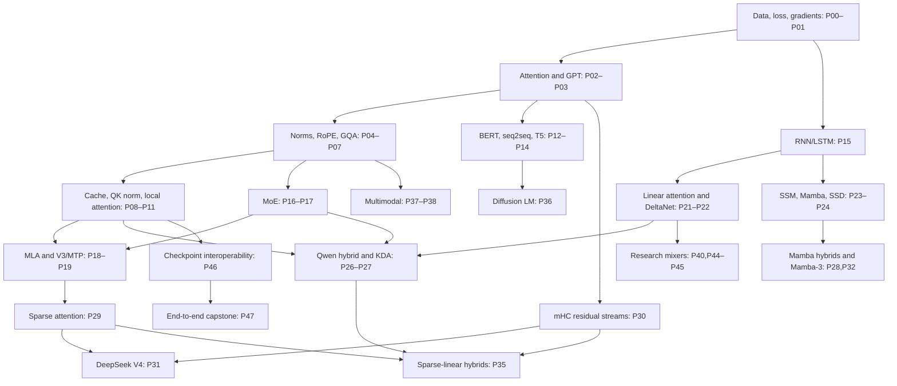

# LLM architecture implementation and learning roadmap

Research cutoff: **2026-10-09**. Local audit baseline: `1bf6c6ac6b88e3ac84b0db12566fbf29e7380866`.

Build a comprehensive, evidence-backed learning repository: understand the equations, implement the mechanisms, train tiny examples, compare results, and assemble faithful model recipes. The four-week plan below is **only the opening stage**, not the scope of this roadmap. The full program includes the major publicly documented language-model families, popular model generations, recent architectural innovations, and a research watchlist.

**Scope: 48 implementation work packages, 150 named-model/family catalog entries, eight learning phases, and a four-week starting plan.** The catalog is broad coverage; related releases share implementations.

Read the [reference repository comparison](docs/reference-repositories.md) for source inspections, maintenance, licenses, and reusable ideas. All implementation work below is **planned**; this documentation task adds no model code.

## 1. Audit: what this repository actually contains

`git ls-files`, the recursive working-tree file inventory, and Git history showed **one tracked file: `LICENSE`**, carrying an MIT license. HEAD is the initial commit. The working tree was clean before this task. No applicable `AGENTS.md` was found in the repository or checked ancestor paths. The environment-owned `.agents`, `.codex`, and `.aws` directories contained no project files returned by the inventory.

| Area | Audit finding | Consequence |
|---|---|---|
| README, docs, examples | Absent | No established learning sequence or claimed architecture coverage |
| Model and component implementations | Absent | Zero working implementations; zero placeholders to classify |
| Training, tokenization, inference | Absent | Need a small common experimental harness |
| Tests and CI | Absent | No evidence of shape, gradient, masking, cache, or numerical correctness |
| Packaging/dependency configuration | Absent | No existing framework to retain; recommend plain PyTorch |
| Reusable foundation | MIT license and clean repository | Preserve the license; establish conventions before adding many architectures |

There are no code defects to diagnose locally because there is no implementation. The gaps are missing capabilities, not observed bugs. Competitor code findings are documented separately; they do not establish defects in this repository.

## 2. What “all architectures” should mean here

Count **mechanisms**, **named architecture recipes**, and **training/model releases** separately. Llama 3.1 and a Llama 3.1 instruction checkpoint do not automatically require two architectures. A Qwen model can have a dense FFN while using hybrid linear/full attention: “dense” and “Transformer-only” are different axes.

The deliverable is a large named-model coverage matrix linked to a smaller set of reusable implementation projects. Historical foundations remain because they teach important ideas; recent releases enter after their prerequisites. Popularity is qualitative here—widely used ecosystems, historically influential families, or relevant public implementations—not a measured download ranking. No finite list can certify coverage of every future release.

| Category | Examples | Repository treatment |
|---|---|---|
| Core families | Autoregressive decoder, bidirectional encoder, encoder-decoder, recurrent LM, SSM, linear-attention LM, hybrids, diffusion LM | Independent learning implementations |
| Components | MHA/MQA/GQA/MLA, sparse/local attention, RoPE, relative bias, RMSNorm, QK-Norm, SwiGLU/GeGLU, MoE routing, memory, residual streams | Small independently testable lessons |
| Objectives/procedures | Next-token prediction, MLM, span corruption, denoising, MTP, SFT, DPO, RLVR, distillation | Objective/training track; do not mislabel as new backbones |
| Inference/systems | KV/state caches, FlashAttention, quantization, speculative decoding, batching, sharding | Separate implementation/benchmark track |
| Named releases | Llama, Qwen, Gemma, DeepSeek, Kimi, GLM, Phi, OLMo, etc. | Recipes with exact config, component deltas, and fidelity evidence |
| Undisclosed commercial architectures | GPT-4/5, Claude, Gemini, unreleased internal backbones | Public-evidence notes; no claim of faithful reproduction |

**First three complete models:** (1) bigram LM to prove the data/loss loop, (2) tiny GPT-2-style decoder to learn attention and autoregressive training, (3) tiny Llama-style decoder to learn today's dense template. Their component exercises occur between them. BERT/T5 and recurrent families follow; they are part of the full curriculum.

## 3. Importance, difficulty, and ordering

Scores are recommendations for this learner, not benchmark scores. Re-score when your interests or hardware change.

| Score | Importance (I) | Difficulty (D), for a correct tiny educational implementation |
|---|---|---|
| 1 | Niche, redundant, or optional historical breadth | Straight tensor operations; few numerical traps |
| 2 | Useful comparison/elective | Small component or straightforward recipe variation |
| 3 | Significant alternative or useful specialization | New block/objective, state management, or several interacting choices |
| 4 | Major practical family or high transfer value | Difficult routing, recurrence, compression, or conversion |
| 5 | Essential foundation or central modern mechanism | Multiple difficult mechanisms, advanced mathematics, or substantial verification burden |

Assess importance from **foundational value (50%) + practical relevance (30%) + transfer to other entries (20%)**, each rated 1–5, then round. Difficulty is the highest substantial burden among mathematics, implementation, debugging, and compute/environment requirements. The published scores summarize judgment; they are not measured data. Tiny reference implementations avoid charging full-scale training difficulty to every frontier model.

**Selection rule:** choose only prerequisite-ready entries; finish the current model/component before opening another; prioritize higher I, then lower D, then stronger public evidence. Within a phase the simpler prerequisites come first. Difficulty is not globally monotonic: an easy recipe appears later if its harder components are prerequisites. Broad low-priority recipes can wait while high-priority mechanisms advance.



This graph highlights major paths; the per-entry prerequisites below are authoritative. P20 supplies long-context comparisons. P33 and P34 supply Gemma4 and conditional memory foundations for later recipe breadth.

## 4. Affordable experiment and completion contract

Assume Python/tensor basics and **8–12 hours of study per week**; add a preparatory PyTorch/backprop course if needed. No local GPU specifications were inspected. Proposed tiers, not measured requirements:

| Tier | Proposed target | Intended use |
|---|---|---|
| C | CPU, roughly 8–16 GB system RAM; 0.1–3M parameters, context 32–128 | Equations, fixtures, synthetic tasks, smoke training |
| G | One GPU with 8–12 GB VRAM; roughly 3–20M parameters, context 128–512 | Tiny text training and controlled ablations |
| G+ | One 16–24 GB GPU, reduced batches and optional accumulation | Larger experiments, longer sequences, real small checkpoints |
| X | Optional specific accelerator/kernel or multi-GPU environment | Performance engineering and large model reproduction |

Use byte/character tokens first, then BPE. Limit vocabularies in toy runs: vocabulary embeddings can dominate memory even when the layer stack is tiny. Keep every core algorithm available as a CPU-compatible reference; GPU kernel checks may require a separately documented environment. Naive quadratic or recurrent code will not demonstrate production throughput.

Every Pxx item has a slug in the tables. A model project produces `architectures/<slug>/model.py`, `config.py`, `README.md`, `train_tiny.py`, `experiment.py`, and `tests/test_<slug>.py`. A component project instead produces `components/<slug>.py` plus `lessons/<slug>/README.md`, `experiment.py`, and `tests/test_<slug>.py`. A recipe adds `recipes/<family>/config.json`, `README.md`, and a parity fixture. These are **proposed paths**, not current files. Table-specific paths replace these when appropriate.

Use five evidence levels, recorded independently for each entry:

1. **Documented:** equations, tensor shapes, sources, deviations and intended configuration.
2. **Runnable:** CPU tiny-config forward, backward where applicable, and a documented command.
3. **Tested:** relevant behavior invariants and numerical oracle pass; required core failures are failures, not skipped tests.
4. **Trained:** tiny experiment learns a defined task, with loss/metric curve, config, data hash, and seed.
5. **Reference-verified:** random tiny-config and, when affordable, checkpoint parity against a pinned trusted implementation; optimizer/loss comparisons where applicable.

A completed educational architecture work package needs levels 1–4, plus an independent oracle or an explicit “reference parity pending” label. Named-family recipe rows reuse those trained mechanisms: each additionally needs sourced config, tiny construction, a discriminating experiment and relevant parity evidence. They do not require redundant pretraining of every sibling release. Checkpoint-compatible claims require level 5. A stubbed MTP head, text-only VLM, or unoptimized scan receives its own partial fidelity label.

Standard checks include correct shapes and parameter counts, finite outputs/gradients, causal prefix invariance for autoregressive models, padding/segment isolation, independent batch rows, deterministic save/load, and a tiny overfit run. Add full-versus-cached logits for caches and full/chunk/step equivalence for recurrence. Do **not** apply causal tests to bidirectional encoders or diffusion denoisers. Compare FP32 first; set and justify dtype-specific tolerances rather than using one universal tolerance.

For comparisons, keep corpus split, tokenizer, data order, token budget, optimizer policy, context, and evaluation protocol fixed. Publish both parameter-matched and compute-matched views where possible; MoE total and active parameter budgets differ. Use several seeds for comparative claims. Do not compare raw token perplexity across different tokenizers; byte-normalized likelihood may help when the probability/evaluation conventions permit it. Tiny overfitting proves trainability, not generalization.

## 5. Implementation phases: prerequisite-aware priorities

Effort estimates include understanding, reference implementation, focused tests, and one tiny experiment; they exclude large-scale pretraining. New learners may need twice the estimate. Each row inherits the file and completion contract above and adds a discriminating experiment and acceptance criterion. Papers/docs establish the design; implementation links supply the oracle.

### Phase 0 — Make one trustworthy decoder (P00–P03)

| ID / slug | I / D; prerequisites | Small implementation and experiment | Correctness/completion target | Effort; tier; sources |
|---|---|---|---|---|
| P00 `training_harness` | 5 / 1; Python, tensors, cross-entropy | Explicit batches, shifted labels, AdamW, validation and checkpoint/resume in `training/`; inspect one batch manually | Loss excludes padding; split before overlapping windows; checkpoint retains optimizer/RNG/data progress; resumed deterministic CPU run matches uninterrupted run | 8–16h; C; [nanoGPT training](https://github.com/karpathy/nanoGPT/blob/3adf61e154c3fe3fca428ad6bc3818b27a3b8291/train.py) |
| P01 `bigram` | 4 / 1; P00 | Token-to-next-token table; train on a tiny corpus; compare context-free baseline to later models | Hand-computed cross-entropy agrees; backward updates expected rows; loss drops on a small fixture | 4–8h; C; [author's language-model course](https://github.com/karpathy/nn-zero-to-hero) |
| P02 `attention` | 5 / 2; P01, batched matrix products | Single-head then MHA, explicit masks; synthetic next-token dependency | Independent loop oracle agrees; perturbing future tokens cannot alter past outputs; mask polarity and fully masked rows are deliberate | 8–16h; C; [Transformer paper](https://arxiv.org/abs/1706.03762), [Annotated Transformer](https://nlp.seas.harvard.edu/annotated-transformer/) |
| P03 `gpt2` | 5 / 3; P02 | Pre-norm decoder, learned positions, GELU FFN, causal MHA, final norm, tied token head; compare with bigram on held-out text | Target shift, weight tying, gradients, causal invariance, tiny overfit and random-config reference logits pass | 16–32h; C/G; [GPT-2 report](https://cdn.openai.com/better-language-models/language_models_are_unsupervised_multitask_learners.pdf), [nanoGPT model](https://github.com/karpathy/nanoGPT/blob/3adf61e154c3fe3fca428ad6bc3818b27a3b8291/model.py) |

**Phase done:** fresh setup can train, save, resume, evaluate and generate with a tiny GPT; the masked-attention test fails when its causal mask is deliberately removed. Record results before changing the decoder template.

### Phase 1 — Modern dense components and baseline (P04–P11)

| ID / slug | I / D; prerequisites | Small implementation and experiment | Correctness/completion target | Effort; tier; sources |
|---|---|---|---|---|
| P04 `norms_glu` | 5 / 2; P03 | LayerNorm/RMSNorm, pre/post normalization, GELU/SwiGLU/GeGLU; parameter-matched FFN ablation | Formulas and gradients match a direct oracle; eps, accumulation dtype, bias and hidden widths explicit | 8–16h; C/G; [RMSNorm](https://arxiv.org/abs/1910.07467), [GLU variants](https://arxiv.org/abs/2002.05202), [LitGPT blocks](https://github.com/Lightning-AI/litgpt/blob/18c931c15c2398621d35371a12d2b1785e855bb6/litgpt/model.py) |
| P05 `rope` | 5 / 2; P02 | Rotary positions with head-dimension shapes and decode offsets; compare to learned positions | Complex-number oracle agrees; rotation preserves norm; offset/chunk results agree; pairing convention is explicit | 8–16h; C; [RoFormer](https://arxiv.org/abs/2104.09864), [Llama reference](https://github.com/meta-llama/llama3/blob/main/llama/model.py) |
| P06 `gqa` | 5 / 2; P02 | MHA→GQA→MQA using fewer K/V heads; calculate cache memory at fixed context | Grouping agrees with explicitly repeated K/V; MHA and MQA endpoints work; head divisibility checked | 8–16h; C/G; [GQA](https://arxiv.org/abs/2305.13245), [Llama reference](https://github.com/meta-llama/llama3/blob/main/llama/model.py) |
| P07 `llama_dense` | 5 / 3; P04–P06 | Combine RMSNorm, RoPE, GQA, SwiGLU and bias policy; compare tiny GPT and tiny Llama at controlled budget | Model/config parity with one exact reference recipe; no assumed tying, RoPE scaling or FFN width based on name alone | 16–32h; C/G; [Llama 3 report](https://arxiv.org/abs/2407.21783), [official code](https://github.com/meta-llama/llama3) |
| P08 `kv_cache` | 5 / 3; P07 | Prefill and one-token decode; measure time and memory versus repeated full prefixes | Full/cached logits agree over multiple batch sizes, offsets, padding patterns and reset; cache stores K/V heads rather than expanded copies | 12–24h; C/G; [Transformers caching](https://huggingface.co/docs/transformers/main/en/cache_explanation), [nanochat engine](https://github.com/karpathy/nanochat/blob/92d63d4e8bb4df75c3b71618f31ddde2378b2bcd/nanochat/engine.py) |
| P09 `qk_norm` | 4 / 2; P07 | Q/K normalization and Qwen3 dense recipe; compare attention-logit scales before and after normalization | Per-head axes, epsilon, affine weights and placement match pinned Qwen3 config/code; cache parity maintained | 8–16h; C/G; [Qwen3 author release](https://qwenlm.github.io/blog/qwen3/), [model implementation](https://github.com/huggingface/transformers/tree/9c59c0c6733990bbf8b1be7cb93b97e57dc73c39/src/transformers/models/qwen3) |
| P10 `local_global_attention` | 4 / 3; P08–P09 | Sliding-window attention plus explicit local/global layer schedule; Mistral then Gemma3 text recipe; distance-retrieval experiment | Dense masked oracle agrees at window boundaries; decode ring-buffer offsets pass; Gemma3's QK-Norm and 5:1 local/global schedule verified; Gemma2 softcapping not inherited by assumption | 16–32h; C/G; [Mistral](https://arxiv.org/abs/2310.06825), [Gemma3 report](https://arxiv.org/abs/2503.19786), [Gemma3 implementation](https://github.com/huggingface/transformers/tree/9c59c0c6733990bbf8b1be7cb93b97e57dc73c39/src/transformers/models/gemma3) |
| P11 `position_variants` | 3 / 3; P05,P08 | Sinusoidal, relative bias, ALiBi, partial/scaled RoPE, YaRN and NoPE ablations; separate each extension | Hand-computed bias/rotation fixtures and cache offsets agree; report extrapolation failure as well as success | 16–32h; C/G; [ALiBi](https://arxiv.org/abs/2108.12409), [YaRN](https://arxiv.org/abs/2309.00071), [LitGPT positional code](https://github.com/Lightning-AI/litgpt/blob/18c931c15c2398621d35371a12d2b1785e855bb6/litgpt/model.py) |

**Phase done:** one reference-verified dense recipe, cache parity, and a written table explaining which differences are independent mechanisms versus config changes. P09 is easier than P08 but is scheduled after the first complete dense baseline; P11 is lower-priority breadth.

### Phase 2 — Complete the foundational family coverage (P12–P15)

| ID / slug | I / D; prerequisites | Small implementation and experiment | Correctness/completion target | Effort; tier; sources |
|---|---|---|---|---|
| P12 `bert_encoder` | 4 / 3; P03 | Bidirectional encoder and MLM head; reconstruction experiment, then RoBERTa/ALBERT/ModernBERT recipe deltas | Nonselected tokens ignored by MLM loss; padding isolated; bidirectionality is demonstrable; architecture vs NSP/MLM objective separated | 16–32h; C/G; [BERT](https://arxiv.org/abs/1810.04805), [reference models](https://github.com/huggingface/transformers/tree/9c59c0c6733990bbf8b1be7cb93b97e57dc73c39/src/transformers/models/bert) |
| P13 `encoder_decoder` | 5 / 3; P03,P12 | Original Transformer with cross-attention, then BART recipe; synthetic copy/reversal | Source/target padding and target shift correct; decoder causal, encoder bidirectional; cross-attention changes output when source changes | 16–32h; C/G; [Transformer](https://arxiv.org/abs/1706.03762), [Annotated Transformer code](https://github.com/harvardnlp/annotated-transformer) |
| P14 `t5` | 4 / 3; P13,P11 | Relative-bias encoder-decoder and span-corruption sentinel targets; compare denoising schemes | Exact sentinel/target construction, relative buckets and weight mapping verified; FLAN treated as post-training, not a new backbone | 16–32h; C/G; [T5](https://arxiv.org/abs/1910.10683), [reference implementation](https://github.com/huggingface/transformers/tree/9c59c0c6733990bbf8b1be7cb93b97e57dc73c39/src/transformers/models/t5) |
| P15 `rnn_lstm` | 4 / 2; P01 | Vanilla RNN and LSTM with explicit hidden state; copy/counting tasks versus tiny GPT | Step/sequence agreement, zero/reset state and gradient-through-time behavior tested; truncated BPTT marked separately | 12–24h; C; [LSTM paper](https://www.bioinf.jku.at/publications/older/2604.pdf), [PyTorch RNN oracle](https://docs.pytorch.org/docs/stable/generated/torch.nn.LSTM.html) |

**Phase done:** correctly distinguish causal generation, bidirectional representation, conditional generation and recurrent state. This phase closes the major omissions in a decoder-only curriculum. P15 can move earlier if recurrence is unfamiliar.

### Phase 3 — Conditional computation and latent attention (P16–P20)

| ID / slug | I / D; prerequisites | Small implementation and experiment | Correctness/completion target | Effort; tier; sources |
|---|---|---|---|---|
| P16 `sparse_moe` | 5 / 3; P07 | Top-1 Switch-style, then top-2 Mixtral-style expert FFNs and balance loss; four tiny experts versus dense FFN | Explicit routing-loop oracle agrees; dispatch/combine conserves weighted tokens; selected experts/router receive gradients; report capacity and dropped tokens | 16–32h; C/G; [Switch](https://arxiv.org/abs/2101.03961), [Mixtral](https://arxiv.org/abs/2401.04088), [Mixtral code](https://github.com/huggingface/transformers/tree/9c59c0c6733990bbf8b1be7cb93b97e57dc73c39/src/transformers/models/mixtral) |
| P17 `fine_grained_moe` | 4 / 4; P16 | Fine-grained routed experts plus shared experts; auxiliary-loss and bias-based balance policies; utilization/entropy ablation | Routing selection bias kept distinct from combine weights and gradient path; exact scores/group restrictions match chosen recipe; active/total parameters reported | 20–40h; C/G; [DeepSeekMoE](https://arxiv.org/abs/2401.06066), [DeepSeek V3](https://arxiv.org/abs/2412.19437), [author code](https://github.com/deepseek-ai/DeepSeek-V3) |
| P18 `mla` | 5 / 4; P05–P08 | Low-rank KV latent plus decoupled rotary branch; first expanded slow oracle, then absorbed decode projections | Expanded/absorbed outputs agree; causality/cache offsets pass; actual cache includes required latent and rotary state; measure bytes/token | 24–48h; C/G; [DeepSeek V2](https://arxiv.org/abs/2405.04434), [V3 model code](https://github.com/deepseek-ai/DeepSeek-V3/blob/main/inference/model.py) |
| P19 `deepseek_v3_mtp` | 4 / 4; P17,P18 | Assemble tiny V3 recipe and a real one-step MTP branch; next-token vs MTP training experiment | Future targets cannot leak into main causal path; auxiliary loss and parameter sharing explicit; no “full V3” claim when heads are stubbed | 24–48h; G; [V3 report](https://arxiv.org/abs/2412.19437), [official repository](https://github.com/deepseek-ai/DeepSeek-V3) |
| P20 `long_context_transformers` | 3 / 4; P08,P11 | Separate Transformer-XL memory, Longformer/BigBird masks, Reformer/Performer approximations; synthetic long-distance retrieval | Each subproject has a dense/slow oracle and boundary test; approximate attention never called exact; memory detachment and resets explicit | 32–64h across subprojects; C/G; [Transformer-XL](https://arxiv.org/abs/1901.02860), [Longformer](https://arxiv.org/abs/2004.05150), [BigBird](https://arxiv.org/abs/2007.14062), [reference model collection](https://github.com/huggingface/transformers) |

**Phase done:** MoE router behavior and MLA cache savings are demonstrated at tiny scale. DeepSeek-R1 shares the V3 backbone in its full model; R1-distilled checkpoints retain their student backbone. Reasoning post-training is a separate track. [R1 report](https://arxiv.org/abs/2501.12948)

### Phase 4 — Recurrence, state space, and the first hybrids (P21–P28)

| ID / slug | I / D; prerequisites | Small implementation and experiment | Correctness/completion target | Effort; tier; sources |
|---|---|---|---|---|
| P21 `linear_attention` | 4 / 3; P02,P15 | Causal positive-feature linear attention with numerator/normalizer states; memory and associative-recall experiment | Direct prefix sums and recurrent outputs agree; normalizer stability, reset and causality tested; no claim of exact softmax equivalence | 16–32h; C/G; [linear attention](https://arxiv.org/abs/2006.16236), [FLA references](https://github.com/fla-org/flash-linear-attention) |
| P22 `delta_gated_delta` | 5 / 4; P21 | Delta-rule correction then gated forgetting; explicit recurrence, then chunked version; overwrite/erase synthetic memory | Sequence/chunk/token outputs and final states agree, including nonzero initial state and uneven chunks; gradients agree on tiny FP32 tensors | 24–48h; C/G; [Gated DeltaNet](https://arxiv.org/abs/2412.06464), [naive recurrence/chunk code](https://github.com/fla-org/flash-linear-attention/blob/855e502613d47d8cc139153f0d87ecae5831ac3c/fla/ops/gated_delta_rule/naive.py) |
| P23 `selective_ssm` | 4 / 4; P15 | Diagonal SSM/discretization lesson, then selective Mamba-1 block and causal convolution; copy/selection task | Slow scan oracle, state initialization and convolution cache boundaries agree; stable parameterization and discretization documented | 24–48h; C/G; [Mamba](https://arxiv.org/abs/2312.00752), [official block](https://github.com/state-spaces/mamba/blob/e9594ce1c732d97440f0332fdc43170a2294dbfa/mamba_ssm/modules/mamba_simple.py) |
| P24 `ssd_mamba2` | 4 / 4; P23 | Structured state-space duality and blockwise scan; compare Mamba1/Mamba2 and direct recurrence | Minimal SSD oracle and carried states agree across lengths/chunks; numerical stability tested before a fused kernel | 24–48h; C/G; [SSD paper](https://arxiv.org/abs/2405.21060), [minimal code](https://github.com/state-spaces/mamba/blob/e9594ce1c732d97440f0332fdc43170a2294dbfa/mamba_ssm/modules/ssd_minimal.py) |
| P25 `rwkv` | 3 / 4; P15,P21 | Start with simple time/channel mixing, then RWKV6/7 matrix-state variants as distinct subprojects; state-tracking comparison | Match reference step outputs; token/sequence state equivalence, reset, numerical stability and gradients documented | 24–48h; C/G; [RWKV7 paper](https://arxiv.org/abs/2503.14456), [author NumPy reference](https://github.com/BlinkDL/RWKV-LM/blob/20be0f8cf0bdf506d8c0030c87a9a3416f95b143/RWKV-v7/rwkv_v7_numpy.py) |
| P26 `qwen_hybrid` | 5 / 4; P09,P16,P22 | Gated DeltaNet + gated full attention; dense FFN first, then shared/routed MoE; separate Qwen3-Next and Qwen3.5 text recipes/configs | Linear/convolution and attention caches agree with full forward; each recipe's layer schedule, gates, norms, rotary details, MTP coverage and MoE selection checked independently | 24–48h; C/G; [Qwen3-Next author details](https://qwen.ai/blog?id=qwen3-next), [Qwen3.5 series](https://github.com/QwenLM/Qwen3.8), [reference implementation](https://github.com/huggingface/transformers/tree/9c59c0c6733990bbf8b1be7cb93b97e57dc73c39/src/transformers/models/qwen3_next) |
| P27 `kda_kimi_linear` | 4 / 4; P18,P22 | Fine-grained KDA gating and hybrid KDA/MLA schedule; fixed-state-budget recall comparison | Recurrent/chunk/state parity; independent caches for each block type; KDA is not a rename of ordinary linear attention | 24–48h; C/G; [Kimi Linear](https://arxiv.org/abs/2510.26692), [author implementation](https://github.com/MoonshotAI/Kimi-Linear) |
| P28 `ssm_attention_hybrid` | 4 / 4; P08,P16,P24 | Tiny Jamba/Zamba/Nemotron-H-like schedules; separate Griffin recurrent/local-attention variant; all-SSM vs hybrid ablation | Per-layer state registry, mixed prefill/decode and sequence resets pass; each named schedule verified independently | 24–48h; C/G; [Nemotron-H author research](https://research.nvidia.com/labs/adlr/nemotronh/), [Jamba paper](https://arxiv.org/abs/2403.19887), [Griffin](https://arxiv.org/abs/2402.19427), [RecurrentGemma code](https://github.com/google-deepmind/recurrentgemma) |

**Phase done:** implement attention-state and recurrent-state models from scratch and explain how their memory grows with sequence length. Pure recurrence has fixed-size state; adding attention generally restores a growing cache in those layers. Constant state does not imply unlimited reliable recall.

### Phase 5 — Frontier mechanisms and architecture integrations (P29–P35)

| ID / slug | I / D; prerequisites | Small implementation and experiment | Correctness/completion target | Effort; tier; sources |
|---|---|---|---|---|
| P29 `learned_sparse_attention` | 4 / 4; P18,P20 | Dense masked sparse oracle, learned indexer/top-k selection, then DeepSeek Sparse Attention recipe; budgeted retrieval experiment | No future selection; selected-index validity, ties, gather/scatter and indexer training tested; dense-when-all-selected endpoint agrees | 24–48h; C/G; [DeepSeek V3.2 author code](https://github.com/deepseek-ai/DeepSeek-V3.2), [reference implementation](https://github.com/huggingface/transformers/tree/9c59c0c6733990bbf8b1be7cb93b97e57dc73c39/src/transformers/models/deepseek_v32) |
| P30 `mhc` | 3 / 4; P03,P04 | Multiple residual streams with constrained mixing; compare ordinary residual stack and mHC on tiny training | Stream shapes and gradients correct; Sinkhorn nonnegativity/row-column sum errors measured; finite iterations not claimed exactly doubly stochastic | 20–40h; C/G; [mHC paper](https://arxiv.org/abs/2512.24880), [V4 implementation](https://github.com/huggingface/transformers/tree/9c59c0c6733990bbf8b1be7cb93b97e57dc73c39/src/transformers/models/deepseek_v4) |
| P31 `deepseek_v4` | 4 / 5; P10,P17,P29,P30 | Build local branch, compressed sparse attention, heavily compressed attention, hash-MoE bootstrap and mHC in stages; compare compressor rates on recall | Compressor never pools future tokens; partial blocks/cache boundaries and sinks tested; integrated tiny-config parity; full frontier weights unnecessary | 40–80h; G/G+; [author model card](https://fe-static.deepseek.com/chat/transparency/deepseek-V4-model-card-EN.pdf), [architecture docs and code links](https://huggingface.co/docs/transformers/main/en/model_doc/deepseek_v4) |
| P32 `mamba3` | 3 / 5; P23,P24 | SSM discretization refinements, complex-state update, then SISO/MIMO variants; state-tracking and state-size ablations | Match official slow/step calculations where available; carried state, real/complex representation and decode paths agree; optimized kernel parity separate | 32–64h; C/G, X for kernels; [Mamba3 paper](https://arxiv.org/abs/2603.15569), [official module](https://github.com/state-spaces/mamba/blob/e9594ce1c732d97440f0332fdc43170a2294dbfa/mamba_ssm/modules/mamba3.py) |
| P33 `gemma4` | 4 / 4; P10,P16; P37/P38 for modality claims | Separate size-specific dense/MoE text recipes, cache-sharing/refinement lessons where configured; multimodal unified model is a separate extension | One selected size matches config and reference; document distinct embedding, cache, attention and modality paths instead of one generic “Gemma4” claim | 24–48h for text, modality budget separate; C/G; [report](https://arxiv.org/abs/2607.02770), [author library](https://github.com/google-deepmind/gemma), [PyTorch implementation](https://github.com/huggingface/transformers/tree/9c59c0c6733990bbf8b1be7cb93b97e57dc73c39/src/transformers/models/gemma4) |
| P34 `conditional_memory` | 3 / 4; P07,P08 | Hashed token n-gram memory and gated integration; lexical-pattern task with collision/memory-size ablation | Deterministic addresses, prefix-only context, collision handling, gradients and decode history match oracle; Engram demo mocks backbone modules, so do not call it a full model reproduction | 20–40h; C/G; [Engram paper](https://arxiv.org/abs/2601.07372), [author demo](https://github.com/deepseek-ai/Engram) |
| P35 `sparse_linear_hybrids` | 4 / 5; P17,P22,P27,P29,P30,P34 | GLM5.3-Flash KDA+DSA recipe, then experimental Qwen4-Exp gated-residual/QSA/per-layer-memory modules as separate recipes | Mixed cache/state agreement, sparse boundary tests and residual invariants; selected upstream omissions (e.g. GLM MTP) explicitly marked | 40–80h across recipes; G; [GLM config](https://huggingface.co/zai-org/GLM-5.3-Flash/blob/main/config.json), [pinned implementation note](https://github.com/huggingface/transformers/blob/9c59c0c6733990bbf8b1be7cb93b97e57dc73c39/docs/source/en/model_doc/glm5_next.md), [Qwen4-Exp docs](https://huggingface.co/docs/transformers/main/en/model_doc/qwen4_exp) |

**Phase done:** at least one compression/sparse integration and one recent alternative run at tiny scale with honest fidelity labels. These projects are the advanced part of the comprehensive program. Selecting just one is a shorter learning milestone; full coverage requires the remaining recipes. P33 is easier than P31/P32 and may be taken first once its prerequisites are ready.

### Phase 6 — Other major generation and modality families (P36–P40)

| ID / slug | I / D; prerequisites | Small implementation and experiment | Correctness/completion target | Effort; tier; sources |
|---|---|---|---|---|
| P36 `diffusion_lm` | 4 / 4; P12,P14 | Masked discrete diffusion with noise schedule, denoising objective and iterative sampler; LLaDA first, then block-diffusion/diffusion-MoE deltas | Corruption and loss weighting independently verified; observed tokens remain fixed when intended; future visibility is intentional; sampler tested across noise/time edge cases | 24–48h; C/G; [LLaDA](https://arxiv.org/abs/2502.09992), [author code](https://github.com/ML-GSAI/LLaDA), [iLLaDA update](https://arxiv.org/abs/2606.25331) |
| P37 `vision_language_connector` | 4 / 3; P07,P13 | Patch embeddings/ViT basics; visual prefix projection (LLaVA/PaliGemma) and cross-attention alternative (Llama Vision/Flamingo) | Patch ordering and modality masks verified; image perturbation affects intended outputs; padding/images cannot cross batch boundaries; tiny synthetic image-caption task learns | 24–48h; C/G; [LLaVA](https://arxiv.org/abs/2304.08485), [author code](https://github.com/haotian-liu/LLaVA), [PaliGemma paper](https://arxiv.org/abs/2407.07726) |
| P38 `early_fusion_omni` | 4 / 5; P37; P26 for Qwen hybrid; P16 for MoE | Early-fusion vision/text, then spatial/temporal positions and audio pathway as distinct subprojects; Qwen3.5/KimiK2.5/Llama4 recipes | Modality alignment, preprocessing, attention masks and text-only paths agree with exact reference; no vision claim for a text-only decoder | 40–80h across subprojects; G/G+; [Qwen3.5 docs](https://huggingface.co/docs/transformers/main/en/model_doc/qwen3_5), [Llama4 author models](https://github.com/meta-llama/llama-models), [KimiK2.5 implementation](https://github.com/huggingface/transformers/tree/9c59c0c6733990bbf8b1be7cb93b97e57dc73c39/src/transformers/models/kimi_k25) |
| P39 `bitnet` | 3 / 4; P07 | BitLinear/ternary weights and activation quantization; compare quantization-aware training to post-training quantization | Quant/dequant fixtures and straight-through gradient policy explicit; FP32 master weights and deployed storage distinguished; fake quantization does not prove fast low-bit execution | 20–40h; C/G; [BitNet b1.58](https://arxiv.org/abs/2402.17764), [author implementation](https://github.com/microsoft/BitNet) |
| P40 `alternative_mixers` | 3 / 4; P15,P21,P23 | **Three separate elective subprojects:** RetNet parallel/recurrent/chunk retention; xLSTM matrix memory; Hyena long convolution/gating | Each gets its own slow oracle, state or convolution-boundary test, gradient check and copy/recall experiment; no shared correctness claim across unrelated mixers | 40–80h across subprojects; C/G; [RetNet](https://arxiv.org/abs/2307.08621), [TorchScale code](https://github.com/microsoft/torchscale), [xLSTM](https://arxiv.org/abs/2405.04517), [author code](https://github.com/NX-AI/xlstm), [Hyena](https://arxiv.org/abs/2302.10866), [author code](https://github.com/HazyResearch/safari) |

**Phase done:** demonstrate a non-autoregressive generation family and at least one multimodal interface; complete the remaining named recipes for comprehensive coverage. Take P37 immediately after its prerequisites if multimodal families are a priority; its position here does not force waiting until every frontier text project is complete.

### Phase 7 — Systems, lifecycle, and research breadth (P41–P47)

| ID / slug | I / D; prerequisites | Small implementation and experiment | Correctness/completion target | Effort; tier; sources |
|---|---|---|---|---|
| P41 `efficient_kernels` | 3 / 5; P08,P22,P24 | Compare naive attention with SDPA/FlashAttention, then one scan/kernel; later quantization, speculative decode and distributed MoE as separate electives | Forward/gradient oracle agreement first; synchronized warm timing, peak memory and environment reported; algorithmic complexity separated from hardware throughput | 32–64h for first kernel track; G/X; [FlashAttention](https://arxiv.org/abs/2205.14135), [official kernels](https://github.com/Dao-AILab/flash-attention), [FLA](https://github.com/fla-org/flash-linear-attention) |
| P42 `post_training` | 4 / 4; P03,P00 | SFT with response masking, LoRA, then DPO; later small verifiable-reward RL/distillation; same backbone comparisons | Hand-computed objectives, frozen/trainable parameter policy, reference-model detach and label masks tested; toy reward gains do not imply general reasoning | 32–64h across first methods; C/G; [LoRA](https://arxiv.org/abs/2106.09685), [DPO](https://arxiv.org/abs/2305.18290), [nanochat scripts](https://github.com/karpathy/nanochat/tree/92d63d4e8bb4df75c3b71618f31ddde2378b2bcd/scripts) |
| P43 `byte_and_hierarchical_models` | 3 / 4; P07,P13 | ByT5 byte baseline, then BLT-style local encoder/patcher/global LM/local decoder; entropy-based patching experiment | Byte reconstruction, patch boundaries, loss alignment and causal patcher tested; tokenization savings compared at byte-normalized protocol | 24–48h; C/G; [BLT](https://arxiv.org/abs/2412.09871), [author implementation](https://github.com/facebookresearch/blt) |
| P44 `cyfa` | 2 / 5; P21,P22 | Relative-time memory slots and cyclic transport; recall-distance ablation at matched state capacity | Recurrent/alternative-coordinate/chunk outputs and states agree on a tiny oracle; research status and limited independent reproduction explicit | 24–48h; C/G; [paper, submitted 2026-09-28](https://arxiv.org/abs/2609.36259), [implementation](https://github.com/fla-org/flash-linear-attention/tree/855e502613d47d8cc139153f0d87ecae5831ac3c/fla/models/cyfa) |
| P45 `compress_attend` | 2 / 4; P10,P13 | CAT chunk compressor and decoder; sweep compression at inference, then train across chunk sizes | Prefix-only chunk summaries, incomplete-chunk handling and full/chunk cache parity; measure quality/latency tradeoff without assuming paper-scale gains | 24–48h; C/G; [CAT paper](https://arxiv.org/abs/2511.05313), [FLA implementations](https://github.com/fla-org/flash-linear-attention) |
| P46 `checkpoint_interop` | 5 / 4; P03,P07,P08; chosen recipe components | Tokenizer/config validation, safetensors loading, conversion and layerwise debugging in `interop/`; start with one small decoder checkpoint | Token IDs, transposition, fused projections, tying, normalization and logits match; dataset/checkpoint licenses and source revision recorded | 24–48h for first family, later family work extra; C/G+; [LitGPT conversions](https://github.com/Lightning-AI/litgpt/tree/18c931c15c2398621d35371a12d2b1785e855bb6/litgpt), [Transformers](https://github.com/huggingface/transformers) |
| P47 `learning_capstone` | 5 / 4; P46,P42; one complete architecture | Train a tiny base LM, evaluate, fine-tune, generate and compare with an alternative mixer using the same harness | A fresh documented environment reproduces saved metrics/config/data hashes; all claim-bearing tests pass; write why differences appeared and what remains uncertain | 32–64h; G; [nanochat end-to-end reference](https://github.com/karpathy/nanochat) |

**Phase done:** an end-to-end reproducible learning project and clearly separated optional systems/research work. P46 is intentionally available soon after the dense baseline; do not postpone interoperability until the final phase if exact compatibility matters. These are work packages: P20/P40/P41/P42 contain multiple independently completed subprojects.

## 6. Latest architecture ledger and evidence boundaries

This is a representative search through the cutoff, not a claim that every September/October paper was discovered. Dates identify the event actually verified; a paper submission or library contribution is not automatically a model release date.

| Candidate | Verified event/date | Evidence and architectural value | Roadmap decision |
|---|---|---|---|
| Qwen3-Next | 2025-09-11 release listed by author | Gated DeltaNet/full-attention hybrid and sparse MoE; [author news](https://github.com/QwenLM/Qwen3.8) | P26; distinct recipe from Qwen3 dense |
| Qwen3.5 | 2026-02-16 initial release | Hybrid + multimodal changes; [author news](https://github.com/QwenLM/Qwen3.8) | P26 text, P38 modalities |
| Mamba-3 | 2026-03-16 arXiv submission | New recurrence/complex-state/MIMO choices, official implementation present; [paper](https://arxiv.org/abs/2603.15569) | P32; significant research alternative |
| DeepSeek V4 | 2026-04-24 API release; 2026-04-27 model card | CSA/HCA, mHC and MoE changes; [author changelog](https://api-docs.deepseek.com/updates/), [model card](https://fe-static.deepseek.com/chat/transparency/deepseek-V4-model-card-EN.pdf) | P31; public details now sufficient for a staged toy implementation |
| Gemma4 | 2026-07-02 report submission, revised 2026-07-24 | Dense/MoE and size-specific multimodal designs, including unified encoder-free variant; [report](https://arxiv.org/abs/2607.02770) | P33/P38; verify each size separately |
| Qwen3.8 | 2026-08-12 MoE and 2026-08-14 27B releases | Author says architectural foundation of Qwen3.5; sampled 27B [config](https://huggingface.co/Qwen/Qwen3.8-27B/blob/main/config.json) uses hybrid `qwen3_5_text` | Recipe coverage under P26; no automatic new mechanism chapter |
| GLM5.3-Flash | Transformers contribution dated 2026-08-26; not asserted as release date | Official [config](https://huggingface.co/zai-org/GLM-5.3-Flash/blob/main/config.json) has 34 linear/KDA and 11 sparse-attention layers; [implementation note](https://github.com/huggingface/transformers/blob/9c59c0c6733990bbf8b1be7cb93b97e57dc73c39/docs/source/en/model_doc/glm5_next.md) omits MTP | P35; separate from GLM5 ordinary MLA/DSA lineage |
| Qwen4-Exp | Transformers contribution dated 2026-08-26 | Documented gated residual, QSA and per-layer lexical memory; [maintainer docs](https://huggingface.co/docs/transformers/main/en/model_doc/qwen4_exp) | P35 experimental recipe; exact public checkpoint/release details not established here |
| DeepSeek V4.1 Flash | 2026-09-10 API release | Author confirms a new multimodal architecture; [changelog](https://api-docs.deepseek.com/updates/). Serving maintainers describe further cache sharing/compression; [implementation discussion](https://www.lmsys.org/blog/2026-09-10-deepseek-v41) | Track separately; do not silently reuse V4 recipe. This audit did not establish complete author-code/checkpoint parity |
| Qwen3.8-Next | 2026-08-31 paper submission | Hybrid, sparse attention, n-gram memory and gated residual innovations; [report](https://arxiv.org/abs/2608.30320) | P26/P34/P35; separate from baseline Qwen3-Next |
| Qwen3.8-Omni | 2026-09-22 paper submission | Native multimodal extension of Next; [report](https://arxiv.org/abs/2609.25611); complete author model implementation not established here | P38/watchlist; do not infer released weights from report availability |
| CyFA | 2026-09-28 paper submission; present in October FLA snapshot | Relative-time-partitioned memory; [paper](https://arxiv.org/abs/2609.36259) | P44, exploratory priority rather than established deployed baseline |

Keep Engram, CAT, new delta-rule refinements, residual attention and tokenizer-free/hierarchical work on the watchlist. Evidence of an implementation does not establish adoption, superiority, or training reproducibility. Do not add unverified product rumors as implementation commitments.

## 7. Repository design that makes the catalog teachable

```text
README.md                         # entry point, coverage and evidence levels
ROADMAP.md                        # this curriculum and named-family catalog
pyproject.toml                    # later: tested dependency range and dev extras
components/                       # small readable operators with tensor contracts
architectures/<slug>/             # model/config/readme/tiny-training/experiment
lessons/<slug>/                   # derivations, worked examples, exercises
recipes/<family>/                 # exact variant config + differences + sources
training/                        # explicit data, loss, train/eval, checkpoint code
interop/                          # optional tokenizer and checkpoint conversion
tests/                            # CPU correctness first, opt-in accelerator checks
experiments/                      # controlled comparisons and small result records
docs/reference-repositories.md    # evidence about external references
docs/architecture-table.md        # later: generated from a coverage registry
.github/workflows/                # later: CPU tests and documentation checks
```

Start with ordinary modules and small dataclass configs. PyTorch fits the requested from-scratch learning goal and the strongest reference ecosystem; there is no existing framework to migrate. Use Transformers only in optional parity tests/import utilities, not to instantiate the educational model. No distributed trainer, plugin system, giant model factory or paid experiment service is needed initially.

Write the first two model lessons transparently even if there is small duplication. Extract a shared operator after two real users agree on its interface. Preserve a complete readable view of a block so that imports do not hide the concept. Optimized modules must retain a slow oracle.

Each lesson should explain: problem solved; equations and tensor shapes; a hand-worked example; parameter count; exact sources/revisions; minimal commands; expected experiment behavior; common failures; exercise; measured result; and deviations from the named model. An architecture page links to all its component lessons.

The future registry should record family/variant, status level, modality coverage, parameter/config signature, source revision, tested dtype, runnable command, training data hash, experiment result path and outstanding deviations. Validate status transitions from artifacts rather than manually checking “implemented” after a forward pass. Keep checkpoints and large datasets outside Git.

## 8. First four weeks: the opening 40-ish hours

Target five sessions of roughly two hours per week. Treat checkpoints as gates, not deadlines; extend the month if Python/PyTorch basics or debugging require it. This plan does **not** attempt the huge catalog in one month. A complete Llama model is the next major milestone after the GPT foundation and its component lessons.

| Week | Sessions and concrete tasks | Reviewable result |
|---|---|---|
| 1 | 1: README learning contract, package/dev setup. 2: tiny data fixture and split/hash. 3: manually inspect shifted batches/loss. 4: bigram model + train/eval. 5: checkpoint save/load and baseline result | P00 starter + P01; explain one batch and demonstrate loss improvement; resume equivalence can continue in week 2 |
| 2 | 1: single-head attention by hand. 2: vectorized vs loop oracle. 3: causal/padding/segment masks. 4: MHA reshape/head mapping. 5: causality and gradient checks; complete resume test | P02 and reliable harness; deliberately remove mask and observe test failure |
| 3 | 1: GPT residual/norm/FFN block. 2: embeddings/positions/tied output. 3: integrate model/loss. 4: tiny overfit and generation. 5: debug layerwise against a tiny random reference | P03 runnable/tested; reference parity may extend into week 4 |
| 4 | 1: finish GPT parity. 2: short held-out run and record curve. 3: compare bigram/GPT fairly. 4: RMSNorm/SwiGLU equations and small fixtures. 5: retrospective and prepare RoPE/GQA lessons | P03 trained with known limitations; begin P04; choose exact Llama recipe for weeks 5 onward |

Next opening milestones: P04–P07 complete the Llama baseline; P08 cache parity; P09/P10 Qwen/Gemma deltas. Then proceed through foundational other families, MoE/MLA and recurrent/hybrid branches. A first implementation is complete only when its completion contract is satisfied.

## 9. Duration: a comprehensive repository versus one month

The project has **48 numbered work packages**, several containing independent subprojects, plus the much larger named-family catalog below. Model names are not equal-sized tasks. A sibling recipe may need a few hours after components exist; a new recurrent or compressed-attention mechanism can take weeks.

The work-package ranges are planning estimates, not performance measurements. The 48 listed ranges sum to **1,028–2,056 hours**, including bundled subprojects; shared work and skipped electives reduce it, while exhaustive subvariant validation can increase it. Extensive family-specific conversion/parity and polished explanations add work beyond a single representative per package.

| Scope | Approximate focused effort | At 10 hours/week |
|---|---|---|
| First month | 32–48h | About four weeks; foundations only |
| Selected mechanism survey | 250–450h | About 6–11 months; does not finish the complete catalog |
| Full readable mechanism program and representative experiments | Roughly 1,000–2,100h | About 1.9–4 years |
| Broad named-family fidelity, interoperability and documentation | Additional 400–1,000h, depending on shared recipes | About 10–23 additional months |
| Frontier-scale pretraining / optimized multi-GPU reproduction | Separate research and compute budget | No credible universal timeline |

The full mechanism program plus broad recipe coverage is roughly **1,400–3,100 focused hours**, or **2.7–6 years at 10 hours/week**. These scenarios overlap rather than add: the selected survey is a subset of the full program. At 20 hours/week calendar estimates roughly halve. Unknown skill/hardware and publication changes make precise deadlines unjustified. Deliver a useful repository after every phase instead of waiting for the entire atlas to finish.

## 10. Comparison with the supplied Grok roadmap

The useful ideas retained are GPT → modern dense → MoE/MLA → hybrid progression, explicit component differences, readable implementations, and a living architecture table. The expanded roadmap makes the scope much larger while distinguishing recipes from new mechanisms.

| Grok suggestion | Keep or improve | Reason and resulting change |
|---|---|---|
| GPT-2 first, then Llama dense | Keep, add data/bigram/attention prerequisites | Provides a concrete trainable baseline before architectural variants |
| Focus largely on modern decoders | Expand | Add original Transformer, BERT-family, T5/BART-family, recurrent/SSM, convolutional, diffusion and multimodal coverage |
| SWA after MoE | Move earlier | Local masking is simpler and reused in dense Gemma/Mistral and later hybrids |
| Mamba/SSM only optional stretch | Make core family coverage | Recurrent state/SSD are prerequisites for understanding major hybrid designs |
| Qwen3-Next / Qwen3.5 as one item | Shared mechanism, separate exact recipes | Text topology and modality/config differences still need independent verification |
| “GLM4.5 / GLM5 = MLA + DSA” | Correct | GLM4.5 uses GQA; GLM5's MLA/DSA and GLM5.3-Flash's sparse/linear hybrid are separate paths; [source implementations](https://github.com/huggingface/transformers/tree/9c59c0c6733990bbf8b1be7cb93b97e57dc73c39/src/transformers/models) |
| “DeepSeek V3 / R1 full architecture” | Separate backbone, objective and checkpoint | Shared backbone does not reproduce reasoning behavior, data or RL; R1 distill variants use different student backbones |
| DeepSeek V4 once public details solid | Update using current evidence | Author card and reference implementation are available; staged V4 is feasible, V4.1 remains a separate evidence question |
| Gemma3 softcapping notes | Verify configuration | Distinguish attention/final softcap fields, enabled values and version-specific norm placements; do not copy Gemma2 settings by assumption |
| Basic shape/parameter/forward validation | Strengthen substantially | Add causality, cache/state parity, routing invariants, tiny training and pinned reference comparisons |
| Checkpoint loading only stretch | Introduce early parity, keep large checkpoints optional | Tiny random configs already provide strong correctness evidence without huge downloads |
| Additional Qwen3.6/3.8 releases | Include as named recipe coverage | Confirm architectural delta; the sampled Qwen3.8-27B keeps the Qwen3.5 hybrid text model type |

The supplied repository recommendations were also checked: [comparison and corrections](docs/reference-repositories.md). Their claims are useful leads, not substitutes for code-level evidence.

## 11. Maintaining comprehensive coverage

Review new architecture publications monthly and refresh reference compatibility quarterly. This is a recommended manual process, not an automation created by this task.

For a candidate, collect author paper/report, exact config, code revision and release date; classify it as mechanism, recipe, training-only update or undisclosed. Identify a difference from an existing recipe before allocating a new implementation. Score I/D, attach prerequisites, and define an affordable discriminating experiment. Missing details remain explicitly unknown.

An implementation graduates only with explanation, tiny runnable config, appropriate behavior tests and an experiment record. “Faithful” additionally needs reference evidence. Keep archived/deprecated references available for learning while selecting maintained or pinned environments for actual comparisons. When a source changes, update the evidence and check affected recipes; do not rewrite unrelated lessons.

Before copying upstream code or figures, inspect their actual license and preserve the relevant attribution. Maintain independent educational implementations where practical. Repository code, weights, datasets, books and images have separate terms; this repo's existing MIT license does not settle those terms.

## 12. Large named-model coverage catalog

The following matrix is the breadth commitment. Rows can group close generations; the count is **catalog rows**, not a count of fundamentally different architectures. Each row links to a work package and source evidence. A source-code path means that a reference exists; it does not establish our implementation is correct or that every detail in a large family is identical.

For each row, create the standard recipe files after its prerequisite projects are complete. Run the experiment and invariants of its assigned package, then verify the row-specific differences with a tiny exact-config comparison. Use **4–12h / C–G** for a familiar recipe delta and **12–32h / G–G+** for a new mapping, tokenizer or multimodal checkpoint path, in addition to its underlying work packages. Larger/new mechanisms use the package estimate. This avoids pretending every named model needs an entirely separate training framework.

All rows start **planned**. Ordering groups ready work by underlying family; within each group prioritize higher importance, then lower difficulty, once prerequisites are met. D uses the full tiny-implementation rubric above; ordinary complete Transformer recipes have a baseline D3. Recipe reuse can make incremental work easier than its full D score suggests.

### Foundations and common decoder variants

| ID | Named model / family | I | D | Required packages | Architectural delta and evidence limits | Primary source / reference |
|---|---|---:|---:|---|---|---|
| C001 | GPT-1 | 5 | 3 | P03 | Decoder-only causal self-attention, learned positions, feed-forward sublayer; useful baseline for next-token pretraining followed by task adaptation. Original checkpoint/code availability is limited. | [paper](https://cdn.openai.com/research-covers/language-unsupervised/language_understanding_paper.pdf) |
| C002 | GPT-2 | 5 | 3 | P03 | Pre-norm decoder with learned absolute position embeddings and causal mask. The key lesson is scale and zero-shot task transfer, not a novel block. | [paper](https://openai.com/research/better-language-models/) |
| C003 | GPT-3 | 5 | 3 | P03 | Autoregressive Transformer lineage; the paper specifies alternating dense and locally banded sparse attention. Learn that mask delta separately from scale and in-context behavior. Weights were not released. | [paper](https://arxiv.org/abs/2005.14165) |
| C004 | LLaMA 1 | 5 | 3 | P07 | RMSNorm, RoPE, SwiGLU, causal attention, and a standard residual decoder stack; strong compact modern baseline. | [code](https://github.com/huggingface/transformers/blob/9c59c0c6733990bbf8b1be7cb93b97e57dc73c39/src/transformers/models/llama/modeling_llama.py) · [paper](https://arxiv.org/abs/2302.13971) |
| C005 | Pythia | 5 | 3 | P07 | GPT-NeoX-style dense decoder. The differentiator is the controlled model/data suite and released intermediate checkpoints, not a new layer type. | [paper](https://arxiv.org/abs/2304.01373) |
| C006 | LLaMA 2 | 5 | 3 | P07 | LLaMA block continued; grouped-query attention is used in the 70B model while smaller sizes differ. Make the head/KV-head relationship configurable. | [paper](https://arxiv.org/abs/2307.09288) · [code](https://github.com/huggingface/transformers/blob/9c59c0c6733990bbf8b1be7cb93b97e57dc73c39/src/transformers/models/llama/modeling_llama.py) |
| C007 | LLaMA 3 / 3.1 / 3.2 / 3.3 text models | 5 | 3 | P07 | Dense GQA decoder lineage; 3.1 extends context with RoPE scaling, while Llama 3.3 is a 70B instruction-tuned release sharing the Llama 3 text architecture. Instruct and reasoning releases are post-training variants. | [Llama 3.3 model card](https://github.com/meta-llama/llama-models/blob/main/models/llama3_3/MODEL_CARD.md) · [code](https://github.com/huggingface/transformers/blob/9c59c0c6733990bbf8b1be7cb93b97e57dc73c39/src/transformers/models/llama/modeling_llama.py) |
| C008 | Qwen 2 / 2.5 dense, including Qwen2.5-Coder | 5 | 3 | P07 | Dense decoder with RoPE and GQA in common configurations; Qwen2.5-Coder keeps the Qwen2.5 architecture and continues pretraining on code. Check checkpoint-specific context and head counts. | [Qwen2 paper](https://arxiv.org/abs/2407.10671) · [Qwen2.5-Coder report](https://arxiv.org/abs/2409.12186) · [code](https://github.com/huggingface/transformers/blob/9c59c0c6733990bbf8b1be7cb93b97e57dc73c39/src/transformers/models/qwen2/modeling_qwen2.py) |
| C009 | Qwen 3 dense | 5 | 3 | P07, P09 | Dense decoder with GQA and QK normalization; thinking/non-thinking mode is a training/template behavior, not a separate dense block. | [paper](https://arxiv.org/abs/2505.09388) · [code](https://github.com/huggingface/transformers/blob/9c59c0c6733990bbf8b1be7cb93b97e57dc73c39/src/transformers/models/qwen3/modeling_qwen3.py) |
| C010 | Gemma 2 | 5 | 3 | P07, P10, P11 | Adds alternating local/global attention, GQA, and attention-logit soft-capping; a compact way to learn nonuniform attention schedules. | [paper](https://arxiv.org/abs/2408.00118) · [code](https://github.com/huggingface/transformers/blob/9c59c0c6733990bbf8b1be7cb93b97e57dc73c39/src/transformers/models/gemma2/modeling_gemma2.py) |
| C011 | Gemma 3 text backbone | 5 | 3 | P07, P10, P11 | Dense text stack with alternating local/global attention and GQA; some checkpoints add a vision front-end, which is outside this text-backbone row. | [paper](https://arxiv.org/abs/2503.19786) · [code](https://github.com/huggingface/transformers/blob/9c59c0c6733990bbf8b1be7cb93b97e57dc73c39/src/transformers/models/gemma3/modeling_gemma3.py) |
| C012 | Mistral 7B | 5 | 3 | P07, P10, P11 | Dense decoder combining GQA with sliding-window attention; implement the window mask and rolling KV-cache behavior as a practical extension. | [paper](https://arxiv.org/abs/2310.06825) · [code](https://github.com/huggingface/transformers/blob/9c59c0c6733990bbf8b1be7cb93b97e57dc73c39/src/transformers/models/mistral/modeling_mistral.py) |
| C013 | Qwen 1 | 4 | 3 | P07 | Dense causal decoder with rotary position handling and gated MLP; version-specific biases, context extension, and attention details vary, so check the selected checkpoint config. | [paper](https://arxiv.org/abs/2309.16609) |
| C014 | OPT | 4 | 3 | P03 | Standard decoder stack with learned positions and pre-LN design; useful for comparing openly documented training and scaling choices with GPT-style models. | [paper](https://arxiv.org/abs/2205.01068) · [code](https://github.com/huggingface/transformers/blob/9c59c0c6733990bbf8b1be7cb93b97e57dc73c39/src/transformers/models/opt/modeling_opt.py) |
| C015 | GPT-Neo | 4 | 3 | P07, P10, P11 | Decoder with configurable global and local-window causal attention layers; implement the mask/window schedule from the target config. | [code](https://github.com/huggingface/transformers/blob/9c59c0c6733990bbf8b1be7cb93b97e57dc73c39/src/transformers/models/gpt_neo/modeling_gpt_neo.py) |
| C016 | GPT-J 6B | 4 | 3 | P07 | Dense decoder with rotary positions and parallel attention/MLP residual branches. Good comparison against sequential residual blocks. | [code](https://github.com/huggingface/transformers/blob/9c59c0c6733990bbf8b1be7cb93b97e57dc73c39/src/transformers/models/gptj/modeling_gptj.py) |
| C017 | GPT-NeoX-20B | 4 | 3 | P07, P10, P11 | Rotary embeddings and parallel residual form in a large, open decoder; configs expose choices such as attention layout and positional scaling. | [code](https://github.com/huggingface/transformers/blob/9c59c0c6733990bbf8b1be7cb93b97e57dc73c39/src/transformers/models/gpt_neox/modeling_gpt_neox.py) |
| C018 | BLOOM | 4 | 3 | P03, P11 | Decoder with ALiBi positional bias, useful contrast to learned positions and RoPE; multilingual tokenizer/training are also part of the family’s story. | [paper](https://arxiv.org/abs/2211.05100) · [code](https://github.com/huggingface/transformers/blob/9c59c0c6733990bbf8b1be7cb93b97e57dc73c39/src/transformers/models/bloom/modeling_bloom.py) |
| C019 | Falcon 7B / 40B / 180B and Falcon 3 | 4 | 3 | P07 | Dense generations differ in attention and positional details. Falcon 3 is Llama-compatible and uses GQA; inspect the chosen legacy Falcon checkpoint rather than projecting its settings across the line. | [Falcon 3 docs](https://falconllm.tii.ae/falcon3/index.html) · [legacy Falcon code](https://github.com/huggingface/transformers/blob/9c59c0c6733990bbf8b1be7cb93b97e57dc73c39/src/transformers/models/falcon/modeling_falcon.py) |
| C020 | MPT | 4 | 3 | P03, P11 | Decoder with ALiBi and an implementation designed around efficient attention; implement ALiBi first, then treat FlashAttention as a kernel optimization rather than a new model block. | [code](https://github.com/huggingface/transformers/blob/9c59c0c6733990bbf8b1be7cb93b97e57dc73c39/src/transformers/models/mpt/modeling_mpt.py) |
| C021 | Qwen 1.5 | 4 | 3 | P07 | Dense Qwen generation bridging Qwen 1 and Qwen 2. No single new block defines all sizes; verify GQA, biases, and context settings by checkpoint. | [Qwen release](https://qwenlm.github.io/blog/qwen1.5/) · [code](https://github.com/huggingface/transformers/blob/9c59c0c6733990bbf8b1be7cb93b97e57dc73c39/src/transformers/models/qwen2/modeling_qwen2.py) |
| C022 | Gemma 1 | 4 | 3 | P07 | Dense decoder with RMSNorm and gated MLP; attention/KV layout differs across model sizes. Use config values rather than generalizing 2B and 7B alike. | [paper](https://arxiv.org/abs/2403.08295) · [code](https://github.com/huggingface/transformers/blob/9c59c0c6733990bbf8b1be7cb93b97e57dc73c39/src/transformers/models/gemma/modeling_gemma.py) |
| C023 | OLMo 1 | 4 | 3 | P07 | Conventional dense causal decoder. Its exceptional learning value is the open data, training code, checkpoints, and logs, which make the full model lifecycle inspectable. | [paper](https://arxiv.org/abs/2402.00838) · [code](https://github.com/huggingface/transformers/blob/9c59c0c6733990bbf8b1be7cb93b97e57dc73c39/src/transformers/models/olmo/modeling_olmo.py) |
| C024 | OLMo 2 / OLMo 3 | 4 | 3 | P07, P09 | Dense decoder line; OLMo 2’s post-norm block is a useful contrast with common pre-norm stacks, and OLMo 3 continues the open model lifecycle. Verify exact norm/residual details per release. | [OLMo 2 paper](https://arxiv.org/abs/2501.00656) · [OLMo 3 paper](https://arxiv.org/abs/2512.13961) · [code](https://github.com/huggingface/transformers/blob/9c59c0c6733990bbf8b1be7cb93b97e57dc73c39/src/transformers/models/olmo3/modeling_olmo3.py) |
| C025 | Phi-3 / Phi-3.5 | 4 | 3 | P07 | Dense Phi-3/Phi-3.5 lineage; MHA/GQA and positional scaling are size-specific (do not assume every Mini/Small/Medium checkpoint uses GQA). Verify the chosen config before assembling the recipe. | [paper](https://arxiv.org/abs/2404.14219) · [code](https://github.com/huggingface/transformers/blob/9c59c0c6733990bbf8b1be7cb93b97e57dc73c39/src/transformers/models/phi3/modeling_phi3.py) |
| C026 | Phi-4 | 4 | 3 | P07 | Dense decoder implemented as `phi3` (`Phi3ForCausalLM`) in its official config; it uses GQA. The report emphasizes data and training choices rather than a new block family. | [Microsoft model config](https://huggingface.co/microsoft/phi-4/blob/main/config.json) · [paper](https://arxiv.org/abs/2412.08905) · [code](https://github.com/huggingface/transformers/blob/9c59c0c6733990bbf8b1be7cb93b97e57dc73c39/src/transformers/models/phi3/modeling_phi3.py) |
| C027 | GLM-4 9B dense | 4 | 3 | P07 | Dense autoregressive GLM decoder. Keep it separate from GLM-4 MoE releases; verify GQA, position encoding, and any prefix/turn conventions from the target checkpoint. | [code](https://github.com/huggingface/transformers/blob/9c59c0c6733990bbf8b1be7cb93b97e57dc73c39/src/transformers/models/glm4/modeling_glm4.py) |
| C028 | SmolLM3 | 4 | 3 | P07, P11 | Dense decoder with GQA and full causal attention in every layer; the config disables RoPE every fourth layer (NoPE) and disables sliding-window attention. It is not a Gated DeltaNet hybrid. | [SmolLM3 config](https://huggingface.co/HuggingFaceTB/SmolLM3-3B/blob/main/config.json) · [code](https://github.com/huggingface/transformers/blob/9c59c0c6733990bbf8b1be7cb93b97e57dc73c39/src/transformers/models/smollm3/modeling_smollm3.py) |
| C029 | Phi-1 / Phi-1.5 / Phi-2 | 3 | 3 | P03 | Compact dense decoder close to the standard Transformer recipe. The teaching value is chiefly data curation/synthetic data and training, rather than a unique block; group Phi-1.5 with Phi-1. | [Phi-1 paper](https://arxiv.org/abs/2306.11644) · [code](https://github.com/huggingface/transformers/blob/9c59c0c6733990bbf8b1be7cb93b97e57dc73c39/src/transformers/models/phi/modeling_phi.py) |
| C030 | StableLM / StableLM 2 | 3 | 3 | P07 | Open dense decoder line whose exact attention, RoPE, and normalization choices vary by release. Use one named checkpoint and read its config rather than assuming a family-wide novelty. | [code](https://github.com/huggingface/transformers/blob/9c59c0c6733990bbf8b1be7cb93b97e57dc73c39/src/transformers/models/stablelm/modeling_stablelm.py) |
| C031 | StarCoder / StarCoder2 | 3 | 3 | P07, P10, P11 | Both are dense code decoders trained for fill-in-the-middle. StarCoder uses multi-query attention; StarCoder2 uses GQA and sliding-window attention. FIM is a training/objective format, not a different Transformer layer. | [StarCoder paper](https://arxiv.org/abs/2305.06161) · [StarCoder2 paper](https://arxiv.org/abs/2402.19173) · [StarCoder code](https://github.com/huggingface/transformers/blob/9c59c0c6733990bbf8b1be7cb93b97e57dc73c39/src/transformers/models/gpt_bigcode/modeling_gpt_bigcode.py) · [StarCoder2 code](https://github.com/huggingface/transformers/blob/9c59c0c6733990bbf8b1be7cb93b97e57dc73c39/src/transformers/models/starcoder2/modeling_starcoder2.py) |
| C032 | Yi 1.5 | 3 | 3 | P07 | LLaMA-like dense decoder family; implement a standard RMSNorm/RoPE/GQA path and confirm any model-size differences from its config. | [official model cards](https://huggingface.co/01-ai) · [code](https://github.com/huggingface/transformers/blob/9c59c0c6733990bbf8b1be7cb93b97e57dc73c39/src/transformers/models/llama/modeling_llama.py) |
| C033 | InternLM 2 / 2.5 | 3 | 3 | P07 | Dense decoder with GQA and long-context positional handling in the family; exact RoPE scaling and head layout depend on the checkpoint. | [paper](https://arxiv.org/abs/2403.17297) · [model code](https://github.com/InternLM/InternLM) |
| C034 | Cohere Command R / R+ | 3 | 3 | P07 | Dense decoder with GQA and long-context support; retrieval/tool-use tuning is not a new block. Check the named model’s positional and sliding-window settings. | [Cohere model docs](https://docs.cohere.com/docs/command-r) · [code](https://github.com/huggingface/transformers/blob/9c59c0c6733990bbf8b1be7cb93b97e57dc73c39/src/transformers/models/cohere/modeling_cohere.py) |
| C035 | Ministral 8B / 14B / Ministral 3 | 3 | 3 | P07 | Mistral-family dense decoder; sliding-window attention and GQA are the main concepts to try. Confirm the exact window schedule and generation for a checkpoint. | [code](https://github.com/huggingface/transformers/blob/9c59c0c6733990bbf8b1be7cb93b97e57dc73c39/src/transformers/models/ministral/modeling_ministral.py) |
| C036 | SmolLM 2 | 3 | 3 | P07 | Small dense decoder family, useful for running full toy-scale experiments; core block is conventional. Focus on tokenizer, data mix, and size-specific config rather than inventing a unique mechanism. | [code](https://huggingface.co/HuggingFaceTB/SmolLM2) |
| C037 | Hunyuan-v1 Dense | 3 | 3 | P07 | Dense decoder family. The available model implementation is a direct entry point, but version-level attention and positional details should be verified from the chosen config before coding. | [code](https://github.com/huggingface/transformers/blob/9c59c0c6733990bbf8b1be7cb93b97e57dc73c39/src/transformers/models/hunyuan_v1_dense/modeling_hunyuan_v1_dense.py) |
| C038 | Apertus | 3 | 3 | P07 | Open multilingual dense decoder family; useful for tokenizer/language coverage and open training practice. Treat the block as standard unless the selected configuration demonstrates otherwise. | [code](https://github.com/huggingface/transformers/blob/9c59c0c6733990bbf8b1be7cb93b97e57dc73c39/src/transformers/models/apertus/modeling_apertus.py) |
| C039 | Granite 3.x dense | 3 | 3 | P07 | Dense decoder family with standard causal attention/MLP pattern across common text checkpoints; long-context and release-specific config differences should be copied from the target model. | [code](https://github.com/huggingface/transformers/blob/9c59c0c6733990bbf8b1be7cb93b97e57dc73c39/src/transformers/models/granite/modeling_granite.py) |
| C040 | DeepSeek LLM (DeepSeek 1 dense) | 3 | 3 | P07 | Dense autoregressive decoder generation preceding DeepSeekMoE and V2. Use the paper/checkpoint for exact block settings; do not import later MoE, MLA, or sparse-attention mechanisms. | [paper](https://arxiv.org/abs/2401.02954) · [official code](https://github.com/deepseek-ai/DeepSeek-LLM) |
| C041 | Code Llama | 3 | 3 | P07 | Llama 2-based dense autoregressive decoder fine-tuned for code; some releases add infilling and longer-context support. The code objective and FIM conventions are the main differences, not a new decoder block. | [Meta model card](https://github.com/meta-llama/codellama/blob/main/MODEL_CARD.md) · [paper](https://arxiv.org/abs/2308.12950) · [Llama code](https://github.com/huggingface/transformers/blob/9c59c0c6733990bbf8b1be7cb93b97e57dc73c39/src/transformers/models/llama/modeling_llama.py) |
| C042 | Granite 4.0 Micro | 3 | 3 | P07 | Conventional dense decoder-only Transformer with GQA, RoPE, SwiGLU, RMSNorm, and tied input/output embeddings. This is the standard-attention counterpart to Granite 4 H-Micro. | [IBM model card](https://huggingface.co/ibm-granite/granite-4.0-micro-base) · [code](https://github.com/huggingface/transformers/blob/9c59c0c6733990bbf8b1be7cb93b97e57dc73c39/src/transformers/models/granite/modeling_granite.py) |
| C043 | CodeGen | 2 | 3 | P03 | GPT-like dense causal decoder for code. Study code-data and multi-turn synthesis objectives separately from the ordinary attention/MLP block. | [paper](https://arxiv.org/abs/2203.13474) |
| C044 | XGLM | 2 | 3 | P03, P11 | Multilingual autoregressive decoder. Core block remains conventional; tokenizer, language coverage, and its positional/config choices are the useful comparison. | [paper](https://arxiv.org/abs/2112.10668) · [code](https://github.com/huggingface/transformers/blob/9c59c0c6733990bbf8b1be7cb93b97e57dc73c39/src/transformers/models/xglm/modeling_xglm.py) |
| C045 | Baichuan 2 | 2 | 3 | P03, P11 | Dense bilingual decoder; useful regional/training comparison. Position and attention details differ across sizes/releases, so inspect the named config. | [paper](https://arxiv.org/abs/2309.10305) · [code](https://github.com/huggingface/transformers/blob/9c59c0c6733990bbf8b1be7cb93b97e57dc73c39/src/transformers/models/llama/modeling_llama.py) |

### Dense extensions and hybrids

| ID | Named model / family | I | D | Required packages | Architectural delta and evidence limits | Primary source / reference |
|---|---|---:|---:|---|---|---|
| C046 | Gemma 4 | 4 | 5 | P33 | New dense generation. Use the model-specific config and current docs to establish layer pattern, attention type, and any hybrid components before implementation; do not assume Gemma 2/3’s schedule. | [code](https://github.com/huggingface/transformers/blob/9c59c0c6733990bbf8b1be7cb93b97e57dc73c39/src/transformers/models/gemma4/modeling_gemma4.py) |
| C047 | Qwen 3.5 / 3.6 / 3.8 dense-text variants | 4 | 5 | P26 | Hybrid Gated DeltaNet linear-attention and full-attention layers; a dense FFN does not make this an ordinary dense-attention Transformer. The Qwen3.8 27B text config uses the Qwen3.5 text architecture; check the target config’s `layer_types`. | [Qwen 3.8 repo](https://github.com/QwenLM/Qwen3.8/blob/main/README.md) · [code](https://github.com/huggingface/transformers/blob/9c59c0c6733990bbf8b1be7cb93b97e57dc73c39/src/transformers/models/qwen3_5/modeling_qwen3_5.py) |
| C048 | OpenELM | 3 | 3 | P07 | Layer-wise scaling: hidden/MLP dimensions vary by depth rather than repeating an isotropic block. Good exercise in config-driven layer construction. | [paper](https://arxiv.org/abs/2404.14619) · [Apple code](https://github.com/apple/corenet) |
| C049 | MiniCPM 3 | 3 | 3 | P18 | Compact dense model using MLA-style compressed latent KV representations; implement cache compression and query/key projections, and verify details against the 4B checkpoint config. | [code](https://github.com/huggingface/transformers/blob/9c59c0c6733990bbf8b1be7cb93b97e57dc73c39/src/transformers/models/minicpm3/modeling_minicpm3.py) |
| C050 | Granite 4.0 H-Micro | 3 | 4 | P28 | Dense-FFN hybrid of Mamba-2 and Transformer attention blocks arranged at roughly a 9:1 ratio (36 Mamba blocks and 4 attention blocks in the 40-layer config); the attention uses NoPE. Compare recurrent state passing with attention KV-cache behavior. | [IBM architecture announcement](https://www.ibm.com/new/announcements/ibm-granite-4-0-hyper-efficient-high-performance-hybrid-models) · [model config](https://huggingface.co/ibm-granite/granite-4.0-h-micro/blob/main/config.json) · [code](https://github.com/huggingface/transformers/blob/9c59c0c6733990bbf8b1be7cb93b97e57dc73c39/src/transformers/models/granitemoehybrid/modeling_granitemoehybrid.py) |

### Sparse MoE and hybrid MoE track

| ID | Named model / family | I | D | Required packages | Architectural delta and evidence limits | Primary source / reference |
|---|---|---:|---:|---|---|---|
| C051 | Mixtral 8x7B | 5 | 4 | P16 | Sparse MoE decoder with 8 experts and top-2 routing per token, plus GQA. Its official base config has `sliding_window: null`; do not inherit Mistral 7B’s sliding-window setting. | [paper](https://arxiv.org/abs/2401.04088) · [base config](https://huggingface.co/mistralai/Mixtral-8x7B-v0.1/blob/main/config.json) · [code](https://github.com/huggingface/transformers/blob/9c59c0c6733990bbf8b1be7cb93b97e57dc73c39/src/transformers/models/mixtral/modeling_mixtral.py) |
| C052 | Qwen 3-MoE | 5 | 4 | P16, P09 | Qwen3 sparse decoder; build on its dense QK-normalized/GQA block, then add routed experts. The 30B-A3B and 235B-A22B generations differ in scale; verify expert/group routing settings per config. | [paper](https://arxiv.org/abs/2505.09388) · [code](https://github.com/huggingface/transformers/blob/9c59c0c6733990bbf8b1be7cb93b97e57dc73c39/src/transformers/models/qwen3_moe/modeling_qwen3_moe.py) |
| C053 | OpenAI gpt-oss 20B / 120B | 5 | 4 | P16, P10, P11 | MoE decoder with alternating dense/local-banded attention, GQA (8 KV groups), and RoPE. The official report gives total/active parameter counts; verify expert count and top-k from the model config. | [OpenAI architecture note](https://openai.com/index/introducing-gpt-oss/) · [official code](https://github.com/openai/gpt-oss) · [implementation](https://github.com/huggingface/transformers/blob/9c59c0c6733990bbf8b1be7cb93b97e57dc73c39/src/transformers/models/gpt_oss/modeling_gpt_oss.py) |
| C054 | Qwen 3.5 / 3.8 MoE | 5 | 5 | P26, P16 | Gated DeltaNet/full-attention hybrid plus sparse MoE. Dense and MoE variants share the hybrid token mixer, but only the latter routes FFN computation. Check expert layout and per-layer schedule. | [Qwen release](https://qwen.ai/blog?id=qwen3.5) · [code](https://github.com/huggingface/transformers/blob/9c59c0c6733990bbf8b1be7cb93b97e57dc73c39/src/transformers/models/qwen3_5_moe/modeling_qwen3_5_moe.py) |
| C055 | DeepSeek-V2 | 5 | 5 | P17, P18 | Combines Multi-head Latent Attention (MLA), which compresses KV state, with DeepSeekMoE fine-grained routed/shared experts. Implement attention and MoE as separate modules first. | [paper](https://arxiv.org/abs/2405.04434) · [code](https://github.com/huggingface/transformers/blob/9c59c0c6733990bbf8b1be7cb93b97e57dc73c39/src/transformers/models/deepseek_v2/modeling_deepseek_v2.py) |
| C056 | DeepSeek-V3 / R1 | 5 | 5 | P19 | V3 uses MLA and DeepSeekMoE with auxiliary-loss-free balancing, shared plus routed experts, and multi-token prediction. R1 is a post-trained reasoning release on this architecture; it is not a separate block family. | [V3 paper](https://arxiv.org/abs/2412.19437) · [code](https://github.com/huggingface/transformers/blob/9c59c0c6733990bbf8b1be7cb93b97e57dc73c39/src/transformers/models/deepseek_v3/modeling_deepseek_v3.py) |
| C057 | LLaMA 4 Scout / Maverick | 5 | 5 | P16, P38 | Sparse MoE decoder with interleaved dense and MoE layers; multimodal versions add early-fusion vision pathways. Keep text MoE routing separate from the multimodal adapter; verify expert counts and active top-k by variant. | [Meta model docs](https://github.com/meta-llama/llama-models) · [code](https://github.com/huggingface/transformers/blob/9c59c0c6733990bbf8b1be7cb93b97e57dc73c39/src/transformers/models/llama4/modeling_llama4.py) |
| C058 | Switch Transformer | 4 | 3 | P14, P16 | Sparse top-1 token-choice routing, expert capacity, and load-balancing loss. A clean first MoE; released research checkpoints exist, but treat it as a research architecture rather than a current general-purpose family. | [paper](https://arxiv.org/abs/2101.03961) · [code](https://github.com/huggingface/transformers/blob/9c59c0c6733990bbf8b1be7cb93b97e57dc73c39/src/transformers/models/switch_transformers/modeling_switch_transformers.py) |
| C059 | Mixtral 8x22B | 4 | 4 | P16 | Same sparse top-2 routing pattern with 8 experts per layer and GQA. Its own official config also has `sliding_window: null`; compare the exact checkpoint config rather than assuming the Mistral 7B attention schedule. | [8x22B config](https://huggingface.co/mistralai/Mixtral-8x22B-v0.1/blob/main/config.json) · [code](https://github.com/huggingface/transformers/blob/9c59c0c6733990bbf8b1be7cb93b97e57dc73c39/src/transformers/models/mixtral/modeling_mixtral.py) |
| C060 | DBRX | 4 | 4 | P16 | Fine-grained MoE with 16 experts and top-4 selection in the released design, plus GQA. Implement routing and expert-weight combine; verify exact dimensions from the base config. | [DBRX repo](https://github.com/databricks/dbrx) · [code](https://github.com/huggingface/transformers/blob/9c59c0c6733990bbf8b1be7cb93b97e57dc73c39/src/transformers/models/dbrx/modeling_dbrx.py) |
| C061 | Qwen 2-MoE | 4 | 4 | P16 | Sparse Qwen decoder with many fine-grained experts and a low active fraction; do not assume the Qwen1.5 expert layout. Verify shared/routed counts and top-k in the checkpoint. | [Qwen2 paper](https://arxiv.org/abs/2407.10671) · [code](https://github.com/huggingface/transformers/blob/9c59c0c6733990bbf8b1be7cb93b97e57dc73c39/src/transformers/models/qwen2_moe/modeling_qwen2_moe.py) |
| C062 | OLMoE | 4 | 4 | P16 | Open sparse decoder with 64 routed experts and top-8 routing in the published 7B/1B-active design; open training details make it useful for studying MoE beyond inference code. | [paper](https://arxiv.org/abs/2409.02060) · [code](https://github.com/huggingface/transformers/blob/9c59c0c6733990bbf8b1be7cb93b97e57dc73c39/src/transformers/models/olmoe/modeling_olmoe.py) |
| C063 | GLM-4.5 / 4.6 | 4 | 4 | P16 | MoE decoder with grouped-query attention; GLM-4.5 uses GQA, not MLA. Verify expert count/top-k for the chosen GLM-4.5/Air/Flash checkpoint. | [Z.ai model docs](https://z.ai/blog/glm-4.5) · [code](https://github.com/huggingface/transformers/blob/9c59c0c6733990bbf8b1be7cb93b97e57dc73c39/src/transformers/models/glm4_moe/modeling_glm4_moe.py) |
| C064 | DeepSeekMoE 16B | 4 | 4 | P17 | Fine-grained routed experts plus always-active shared experts. The original paper describes expert-level and device-level auxiliary balance losses; auxiliary-loss-free balancing belongs to later DeepSeek generations. | [paper](https://arxiv.org/abs/2401.06066) · [official code](https://github.com/deepseek-ai/DeepSeek-MoE) |
| C065 | Qwen 3-Next / Qwen 3.8-Flash-Next | 4 | 5 | P35, P26, P29, P30 | MoE FFN with hybrid Gated DeltaNet/global attention; Qwen3.8-Flash-Next adds Qwen Sparse Attention (QSA) during continued pretraining and a four-branch Gated Residual. The report gives one global-attention layer per four in the pretraining hybrid; verify the target checkpoint’s later schedule. | [Qwen3.8-Next report](https://arxiv.org/abs/2608.30320) · [code](https://github.com/huggingface/transformers/blob/9c59c0c6733990bbf8b1be7cb93b97e57dc73c39/src/transformers/models/qwen3_next/modeling_qwen3_next.py) |
| C066 | DeepSeek-V3.2 | 4 | 5 | P19, P29 | V3-family sparse MoE with DeepSeek Sparse Attention/indexer changes in the published generation. Verify the exact V3.2 checkpoint and whether the target is a post-training-only release or includes the DSA architecture. | [code](https://github.com/huggingface/transformers/blob/9c59c0c6733990bbf8b1be7cb93b97e57dc73c39/src/transformers/models/deepseek_v32/modeling_deepseek_v32.py) |
| C067 | DeepSeek-V4 | 4 | 5 | P31 | Advanced MoE: DeepSeekMoE plus hybrid compressed/sparse attention (CSA/HCA), manifold-constrained hyper-connections, and hash-routed initial MoE layers. This is a late-stage project after MLA, MoE routing, and sparse attention are understood. | [official release](https://deepseek.com/en/news/v4-preview/) · [model docs](https://huggingface.co/docs/transformers/model_doc/deepseek_v4) · [code](https://github.com/huggingface/transformers/blob/9c59c0c6733990bbf8b1be7cb93b97e57dc73c39/src/transformers/models/deepseek_v4/modeling_deepseek_v4.py) |
| C068 | GLM-5 / 5.1 / 5.2 / 5.3 base family | 4 | 5 | P19, P29 | The GLM-5 base model uses the `glm_moe_dsa` architecture: sparse MoE with MLA and DeepSeek Sparse Attention. GLM-5.1–5.3 base revisions should be checked by their configs; do not use the `glm5_next` implementation for this base row. | [GLM-5 config](https://huggingface.co/zai-org/GLM-5/blob/main/config.json) · [technical report](https://arxiv.org/abs/2602.15763) · [code](https://github.com/huggingface/transformers/blob/9c59c0c6733990bbf8b1be7cb93b97e57dc73c39/src/transformers/models/glm_moe_dsa/modeling_glm_moe_dsa.py) |
| C069 | Kimi K2 / K2.5 | 4 | 5 | P17, P18 | Large sparse MoE family; K2.5 is grouped with K2 where the backbone is shared. Verify MLA/attention, shared experts, and router counts against the exact official release before reproducing. The linked K2.5 code is a multimodal reference, not evidence of a separate K2 implementation. | [Moonshot K2 repo](https://github.com/MoonshotAI/Kimi-K2) · [code](https://github.com/huggingface/transformers/blob/9c59c0c6733990bbf8b1be7cb93b97e57dc73c39/src/transformers/models/kimi_k25/modeling_kimi_k25.py) |
| C070 | Jamba | 4 | 5 | P28, P16 | Hybrid stack interleaving Transformer attention, Mamba state-space layers, and MoE FFNs. Implement state passing and layer schedule in addition to sparse routing. | [paper](https://arxiv.org/abs/2403.19887) · [code](https://github.com/huggingface/transformers/blob/9c59c0c6733990bbf8b1be7cb93b97e57dc73c39/src/transformers/models/jamba/modeling_jamba.py) |
| C071 | GLM-5.3-Flash | 4 | 5 | P35, P26, P29, P30 | Separate GLM-5.3-Flash hybrid architecture: sparse attention combined with linear attention, plus MoE. Use its own `glm5_next` config and layer schedule; do not conflate it with GLM-5 base (`glm_moe_dsa`). | [Z.ai release notes](https://autoclaw.z.ai/blog/model/glm-5.3-flash/) · [model config](https://huggingface.co/zai-org/GLM-5.3-Flash/blob/main/config.json) · [code](https://github.com/huggingface/transformers/blob/9c59c0c6733990bbf8b1be7cb93b97e57dc73c39/src/transformers/models/glm5_next/modeling_glm5_next.py) |
| C072 | GLaM | 3 | 4 | P16 | Sparse top-2 MoE routing at large scale. Useful contrast with Switch; the original paper is the reference, and this is not a broadly available open-weight checkpoint family. | [paper](https://arxiv.org/abs/2112.06905) |
| C073 | ST-MoE | 3 | 4 | P16 | Sparse top-k expert routing with training-stability techniques including router z-loss. Learn the stabilization objective separately from dispatch mechanics; verify exact model configs. | [paper](https://arxiv.org/abs/2202.08906) |
| C074 | Snowflake Arctic | 3 | 4 | P16 | Hybrid dense/MoE model with a shared dense path and routed experts; layer schedule and expert counts are checkpoint-specific and should be read from the official config. | [Snowflake repo](https://github.com/Snowflake-Labs/snowflake-arctic) |
| C075 | Grok-1 | 3 | 4 | P16 | Open-weight sparse decoder with routed experts. Use the released repository/config for expert count, top-k, and layer schedule rather than extrapolating to closed Grok generations. | [xAI repo](https://github.com/xai-org/grok-1) |
| C076 | Qwen 1.5-MoE | 3 | 4 | P16 | Sparse expert decoder aimed at low activated-parameter count. Verify expert count, top-k, and any shared experts from the named checkpoint config. | [Qwen release](https://qwenlm.github.io/blog/qwen1.5/) · [code](https://github.com/huggingface/transformers/blob/9c59c0c6733990bbf8b1be7cb93b97e57dc73c39/src/transformers/models/qwen2_moe/modeling_qwen2_moe.py) |
| C077 | GLM-4 MoE variants | 3 | 4 | P16 | Sparse GLM decoder family exists alongside dense GLM-4 9B. Do not label every GLM-4 checkpoint MoE; verify exact variant, router, and attention config. | [code](https://github.com/huggingface/transformers/blob/9c59c0c6733990bbf8b1be7cb93b97e57dc73c39/src/transformers/models/glm4_moe/modeling_glm4_moe.py) |
| C078 | Granite MoE and Granite 4 H-Tiny / H-Small | 3 | 5 | P28, P16 | Keep the standard Granite MoE decoder separate from Granite 4 H-Tiny/H-Small: the latter pair the Mamba-2/attention hybrid stack with MoE FFNs. The H-Micro dense hybrid is listed separately. Follow each checkpoint config for its layer and expert schedule. | [Granite MoE code](https://github.com/huggingface/transformers/blob/9c59c0c6733990bbf8b1be7cb93b97e57dc73c39/src/transformers/models/granitemoe/modeling_granitemoe.py) · [Granite hybrid code](https://github.com/huggingface/transformers/blob/9c59c0c6733990bbf8b1be7cb93b97e57dc73c39/src/transformers/models/granitemoehybrid/modeling_granitemoehybrid.py) · [IBM Granite 4 docs](https://www.ibm.com/granite/docs/models/granite4-0) |
| C079 | ERNIE 4.5 MoE | 3 | 5 | P16 | Large sparse decoder. Expert routing, attention type, and shared-expert structure are release-specific; use the official checkpoint config and mark any undocumented detail for verification. | [code](https://github.com/huggingface/transformers/blob/9c59c0c6733990bbf8b1be7cb93b97e57dc73c39/src/transformers/models/ernie4_5_moe/modeling_ernie4_5_moe.py) |
| C080 | Hunyuan-v1 MoE | 3 | 5 | P16 | Sparse decoder counterpart to Hunyuan-v1 Dense. Verify expert count/top-k and whether attention differs by checkpoint; do not infer details from the dense sibling. | [code](https://github.com/huggingface/transformers/blob/9c59c0c6733990bbf8b1be7cb93b97e57dc73c39/src/transformers/models/hunyuan_v1_moe/modeling_hunyuan_v1_moe.py) |
| C081 | Liquid LFM2-MoE | 3 | 5 | P16, P40 | MoE variant of the LFM2 hybrid: gated short-range convolution blocks alternate with GQA blocks. Its token mixer is not a generic linear-recurrent layer; follow the selected MoE config for exact schedule and expert placement. | [LFM2 MoE design](https://www.liquid.ai/blog/lfm2-8b-a1b-an-efficient-on-device-mixture-of-experts) · [code](https://github.com/huggingface/transformers/blob/9c59c0c6733990bbf8b1be7cb93b97e57dc73c39/src/transformers/models/lfm2_moe/modeling_lfm2_moe.py) |
| C082 | LongCat-Flash | 3 | 5 | P16 | Large sparse decoder generation. Treat attention type, expert partitioning, and active top-k as config/doc questions before coding; this catalog does not infer them from the model name. | [code](https://github.com/huggingface/transformers/blob/9c59c0c6733990bbf8b1be7cb93b97e57dc73c39/src/transformers/models/longcat_flash/modeling_longcat_flash.py) |
| C083 | MiniMax M2 | 3 | 5 | P16 | Sparse decoder family; exact expert routing and attention pattern should be copied from the official configuration. Good optional breadth after a conventional top-k MoE. | [code](https://github.com/huggingface/transformers/blob/9c59c0c6733990bbf8b1be7cb93b97e57dc73c39/src/transformers/models/minimax_m2/modeling_minimax_m2.py) |
| C084 | Step 3.5 Flash | 3 | 5 | P16 | 45-layer sparse MoE Transformer: 288 routed experts plus one shared expert per layer, top-8 routing, and about 11B of 196B backbone parameters active per token. Its MTP head uses sliding-window attention plus a dense FFN. This is distinct from Step-3.7. | [official release and architecture notes](https://github.com/stepfun-ai/Step-3.5-Flash) · [technical report PDF](https://github.com/stepfun-ai/Step-3.5-Flash/blob/main/step_3p5_flash_tech_report.pdf) |
| C085 | JetMoE | 2 | 4 | P16 | Compact MoE research model; the paper explores experts in both attention and MLP paths. Implement one routed sublayer first, then verify the exact attention/FFN expert placement from the paper. | [paper](https://arxiv.org/abs/2404.07413) · [code](https://github.com/huggingface/transformers/blob/9c59c0c6733990bbf8b1be7cb93b97e57dc73c39/src/transformers/models/jetmoe/modeling_jetmoe.py) |

### Encoder-only families

| ID | Named model / family | I | D | Required packages | Architectural delta and evidence limits | Primary source / reference |
|---|---|---:|---:|---|---|---|
| C086 | BERT | 5 | 3 | P07 | **Architecture / deployed template:** bidirectional Transformer encoder; masked-language modeling plus next-sentence prediction in the original recipe. `src/transformers/models/bert/` | [BERT](https://arxiv.org/abs/1810.04805) |
| C087 | RoBERTa | 5 | 3 | P07 | **Recipe / deployed template:** BERT encoder with dynamic masking, more data/steps, and no next-sentence objective; not a new block topology. `src/transformers/models/roberta/` | [RoBERTa](https://arxiv.org/abs/1907.11692) |
| C088 | ELECTRA | 4 | 3 | P07 | **Architecture + objective / deployed encoder:** a small generator corrupts tokens; a discriminator learns replaced-token detection at every position. `src/transformers/models/electra/` | [ELECTRA](https://arxiv.org/abs/2003.10555) |
| C089 | DeBERTa | 4 | 3 | P07 | **Architecture / deployed encoder:** disentangled content and relative-position attention, with an enhanced mask decoder in the original model. `src/transformers/models/deberta/`, `src/transformers/models/deberta_v2/` | [DeBERTa](https://arxiv.org/abs/2006.03654) |
| C090 | ModernBERT | 4 | 3 | P07 | **Architecture / current encoder template:** bidirectional encoder with alternating local/global attention, rotary positions, GeGLU, unpadding, and long-context training. `src/transformers/models/modernbert/` | [ModernBERT](https://arxiv.org/abs/2412.13663) |
| C091 | DistilBERT | 3 | 3 | P07 | **Recipe / deployed compact model:** student distilled from BERT with soft-target, MLM, and cosine losses; same encoder-style core, not a new attention architecture. `src/transformers/models/distilbert/` | [DistilBERT](https://arxiv.org/abs/1910.01108) |
| C092 | ALBERT | 3 | 3 | P07 | **Architecture + objective:** factorized embedding parameters, cross-layer weight sharing, and sentence-order prediction reduce parameter count. `src/transformers/models/albert/` | [ALBERT](https://arxiv.org/abs/1909.11942) |

### Encoder-decoder and text-to-text families

| ID | Named model / family | I | D | Required packages | Architectural delta and evidence limits | Primary source / reference |
|---|---|---:|---:|---|---|---|
| C093 | FLAN-T5 | 5 | 3 | P07 | **Recipe / deployed instruction-tuned template:** instruction tuning over many tasks sits on the T5 encoder-decoder; it is not a separate architecture. Loads through the T5 implementation; no `flan_t5` model directory. | [FLAN](https://arxiv.org/abs/2210.11416) |
| C094 | T5 | 5 | 3 | P07 | **Architecture / deployed template:** encoder-decoder Transformer with relative-position bias and a unified text-to-text interface; span corruption is the pretraining objective. `src/transformers/models/t5/` | [T5](https://arxiv.org/abs/1910.10683) |
| C095 | BART | 4 | 3 | P07 | **Architecture / deployed seq2seq template:** bidirectional encoder and autoregressive decoder trained to reconstruct text after varied corruption, including span infilling and sentence permutation. `src/transformers/models/bart/` | [BART](https://arxiv.org/abs/1910.13461) |
| C096 | mT5 | 4 | 3 | P07 | **Model family / deployed multilingual template:** T5 encoder-decoder and span corruption scaled to multilingual data and vocabulary; no novel layer topology. `src/transformers/models/mt5/` | [mT5](https://arxiv.org/abs/2010.11934) |
| C097 | LongT5 | 3 | 3 | P07 | **Architecture extension / research and task model:** T5 with local sliding-window attention or Transient Global attention for long inputs. `src/transformers/models/longt5/` | [LongT5](https://arxiv.org/abs/2112.07916) |
| C098 | UL2 | 3 | 4 | P07 | **Training objective, not a new architecture:** a “Mixture-of-Denoisers” objective combines regular, sequential, and extreme denoising modes on a Transformer backbone. No `ul2` model directory; implementations reuse encoder-decoder code. | [UL2](https://arxiv.org/abs/2205.05131) |
| C099 | T5Gemma / T5Gemma 2 | 3 | 4 | P07, P10, P11 | **Architecture adaptation / released encoder-decoder models:** converts pretrained decoder-only Gemma weights into encoder-decoder form; T5Gemma 2 adds tied embeddings and merged decoder self/cross attention. `src/transformers/models/t5gemma/`, `src/transformers/models/t5gemma2/` | [Google DeepMind model page](https://deepmind.google/models/gemma/t5gemma/) |

### Historical long-context Transformer families

| ID | Named model / family | I | D | Required packages | Architectural delta and evidence limits | Primary source / reference |
|---|---|---:|---:|---|---|---|
| C100 | Longformer | 4 | 3 | P20, P12 | **Architecture / deployed document model:** local sliding-window attention plus selected global-attention tokens avoids dense all-pairs attention on long documents. `src/transformers/models/longformer/` | [Longformer](https://arxiv.org/abs/2004.05150) |
| C101 | Transformer-XL | 3 | 3 | P20, P12 | **Architecture / historical research template:** segment-level recurrence reuses prior hidden states, with relative positional encoding to handle cross-segment context. No Transformer-XL model directory in the pinned inventory. | [Transformer-XL](https://arxiv.org/abs/1901.02860) |
| C102 | XLNet | 3 | 3 | P20 | **Architecture + objective / historical research template:** permutation language modeling with two-stream attention; borrows segment recurrence and relative positions from Transformer-XL. `src/transformers/models/xlnet/` | [XLNet](https://arxiv.org/abs/1906.08237) |
| C103 | BigBird | 3 | 3 | P20, P12 | **Architecture / research and task model:** sparse attention combines local-window, random, and global tokens. The pinned inventory includes the original BigBird implementation at `src/transformers/models/big_bird/` as well as BigBird-Pegasus at `src/transformers/models/bigbird_pegasus/`. | [BigBird](https://arxiv.org/abs/2007.14062) |
| C104 | Reformer | 2 | 4 | P20, P12 | **Architecture / research alternative:** locality-sensitive hashing approximates attention, and reversible residual layers reduce activation memory. `src/transformers/models/reformer/` | [Reformer](https://arxiv.org/abs/2001.04451) |

### Recurrent, SSM, and hybrid families

| ID | Named model / family | I | D | Required packages | Architectural delta and evidence limits | Primary source / reference |
|---|---|---:|---:|---|---|---|
| C105 | Mamba-1 | 5 | 4 | P23 | **Architecture / widely studied alternative:** input-selective state-space parameters let the model retain or forget information by content; a hardware-aware selective scan avoids materializing the full sequence interaction. `src/transformers/models/mamba/` | [Mamba](https://arxiv.org/abs/2312.00752) |
| C106 | Qwen3.5 / Qwen3.6 | 5 | 5 | P26 | **Architecture / current deployed multimodal family:** three Gated DeltaNet linear-attention layers per Gated Attention layer, with multimodal RoPE and a vision tower. Qwen3.6 shares Qwen3.5’s architecture and `model_type`; it is not a separate text topology. `src/transformers/models/qwen3_5/`, `src/transformers/models/qwen3_5_moe/` | [Transformers architecture docs](https://huggingface.co/docs/transformers/model_doc/qwen3_5) |
| C107 | Mamba-2 | 4 | 4 | P24 | **Architecture / research and deployed component:** Structured State Space Duality (SSD) connects selective SSMs with attention-like matrix operations and enables a hardware-efficient multi-head SSM layer. `src/transformers/models/mamba2/` | [Mamba-2 / SSD](https://arxiv.org/abs/2405.21060) |
| C108 | Griffin / RecurrentGemma | 4 | 4 | P28 | **Architecture / released research model:** Griffin mixes gated linear recurrences with local sliding-window attention and keeps a fixed-size recurrent state; RecurrentGemma is its model family. `src/transformers/models/recurrent_gemma/` | [RecurrentGemma](https://arxiv.org/abs/2404.07839) |
| C109 | Jamba | 4 | 5 | P28, P16 | **Architecture / deployed open-weight hybrid:** interleaves Mamba and Transformer attention layers and adds sparse MoE feed-forward blocks. `src/transformers/models/jamba/` | [Jamba](https://arxiv.org/abs/2403.19887) |
| C110 | Nemotron-H | 4 | 5 | P28 | **Architecture / released hybrid family:** replaces most Transformer attention layers with Mamba layers while retaining selected attention; model variants include dense and MoE designs. `src/transformers/models/nemotron_h/` | [Nemotron-H](https://arxiv.org/abs/2504.03624) |
| C111 | Qwen3-Next | 4 | 5 | P26 | **Architecture / deployed open-weight hybrid:** combines Gated DeltaNet with Gated Attention, high-sparsity MoE, and multi-token prediction. `src/transformers/models/qwen3_next/` | [Qwen3-Next docs](https://huggingface.co/docs/transformers/model_doc/qwen3_next) |
| C112 | Kimi Linear | 4 | 5 | P27 | **Architecture / released hybrid alternative:** Kimi Delta Attention adds fine-grained gating to Gated DeltaNet and is interleaved with Multi-head Latent Attention. `src/transformers/models/kimi_linear/` | [Kimi Linear](https://arxiv.org/abs/2510.26692) |
| C113 | GLM-5.3-Flash | 4 | 5 | P35, P26, P29, P30 | **Architecture / deployed multimodal MoE:** the inspected official GLM-5.3-Flash config records 45 text layers (34 KDA linear-attention, 11 DeepSeek sparse-attention), 8 of 288 routed experts per token, and four-branch mHC. `src/transformers/models/glm5_next/`; the pinned Transformers architecture note says its implementation omits the MTP layer. This row is scoped to Flash's newly trained hybrid topology; same-base GLM-5.3 updates are checkpoint/recipe changes unless a source establishes a different block design. | [Official GLM-5 repository](https://github.com/zai-org/GLM-5) |
| C114 | Qwen3.8-27B (dense) | 4 | 5 | P26 | **Checkpoint / deployed multimodal model, not a new text architecture:** official card says it builds on Qwen3.5; the inspected official Qwen3.8-27B config declares top-level `model_type: qwen3_5`, nested `text_config.model_type: qwen3_5_text`, `Qwen3_5ForConditionalGeneration`, and a 48:16 linear/full attention split. `src/transformers/models/qwen3_5/` | [Official Qwen3.8 model card](https://huggingface.co/Qwen/Qwen3.8-27B) |
| C115 | Qwen3.8-Flash-Next | 4 | 5 | P35, P26, P29, P30 | **New hybrid architecture / released frontier model:** 125B sparse MoE with 6B active, large host-prefetched n-gram tables, a 3:1 Gated DeltaNet/global-attention stack, Qwen Sparse Attention in continued pretraining, and four-branch gated residuals. No Qwen3.8-Next model directory in the pinned HF inventory. | [Qwen3.8-Next architecture report](https://arxiv.org/abs/2608.30320) |
| C116 | RWKV-4 | 3 | 3 | P25 | **Architecture / research alternative with released models:** time-mixing implements a weighted key-value recurrence that can be parallelized for training and updated recurrently at inference; channel-mixing supplies the token-wise MLP role. `src/transformers/models/rwkv/` represents the RWKV implementation in this snapshot. | [RWKV](https://arxiv.org/abs/2305.13048) |
| C117 | RetNet | 3 | 3 | P40 | **Architecture / research alternative:** retention has parallel, recurrent, and chunkwise-recurrent forms, supporting parallel training and constant-state token decoding. No RetNet model directory in the pinned inventory. | [RetNet](https://arxiv.org/abs/2307.08621) |
| C118 | xLSTM | 3 | 4 | P40 | **Architecture / research alternative:** sLSTM adds exponential gating and memory mixing; mLSTM uses a matrix-valued memory update to improve capacity and parallel training. `src/transformers/models/xlstm/` | [xLSTM](https://arxiv.org/abs/2405.04517) |
| C119 | RWKV-6 (Finch) | 3 | 4 | P25 | **Architecture / research alternative:** extends RWKV with multi-head matrix-valued recurrent state and dynamic recurrence. The pinned `rwkv` path does not separately establish RWKV-6 support. | [Eagle and Finch](https://arxiv.org/abs/2404.05892) |
| C120 | Zamba 2 | 3 | 4 | P28 | **Architecture / released hybrid model:** Mamba-2 backbone with shared Transformer attention layers; the Zamba2 report covers a family of compact checkpoints. `src/transformers/models/zamba2/` | [Zamba2 technical report](https://arxiv.org/abs/2411.15242) |
| C121 | Mamba-3 | 3 | 5 | P32 | **Research alternative:** adds an SSM-derived recurrence, complex-valued state updates, and a multi-input/multi-output formulation; the authors report improved state tracking. No Mamba-3 model directory in the pinned HF inventory. | [Mamba-3](https://arxiv.org/abs/2603.15569) |
| C122 | RWKV-7 (Goose) | 3 | 5 | P25 | **Architecture / research alternative:** generalizes the delta rule with vector-valued gating and in-context learning rates, while retaining parallel training and recurrent constant-state inference. No RWKV-7 model directory in the pinned HF inventory. | [RWKV-7](https://arxiv.org/abs/2503.14456) |
| C123 | Hyena | 2 | 4 | P40 | **Architecture / research alternative:** replaces attention with implicitly parameterized long convolutions interleaved with data-controlled gating. No Hyena model directory in the pinned inventory. | [Hyena Hierarchy](https://arxiv.org/abs/2302.10866) |
| C124 | Zamba 1 | 2 | 5 | P28 | **Architecture / released hybrid alternative:** Mamba backbone plus a single shared attention module, reducing attention parameter cost. `src/transformers/models/zamba/` | [Zamba](https://arxiv.org/abs/2405.16712) |

### Diffusion language-model families

| ID | Named model / family | I | D | Required packages | Architectural delta and evidence limits | Primary source / reference |
|---|---|---:|---:|---|---|---|
| C125 | LLaDA | 4 | 4 | P36 | **Architecture / research alternative with released weights:** masked discrete diffusion over text; a Transformer predicts masked tokens during iterative reverse denoising. No LLaDA model directory in the pinned inventory. | [Large Language Diffusion Models](https://arxiv.org/abs/2502.09992) |
| C126 | Dream 7B | 3 | 4 | P36 | **Architecture / research alternative with released weights:** discrete diffusion refines tokens iteratively; paper highlights AR initialization and context-adaptive token-level noise rescheduling. No Dream model directory in the pinned inventory. | [Dream 7B](https://arxiv.org/abs/2508.15487) |
| C127 | Block Diffusion / BD3-LMs | 3 | 4 | P36 | **Architecture / research alternative:** autoregressive progression across blocks with parallel denoising within each block; supports variable-length outputs and KV caching between blocks. No family path in the pinned inventory. | [Block Diffusion](https://arxiv.org/abs/2503.09573) |

### Significant multimodal extensions to LMs

| ID | Named model / family | I | D | Required packages | Architectural delta and evidence limits | Primary source / reference |
|---|---|---:|---:|---|---|---|
| C128 | LLaVA | 5 | 3 | P37 | **Architecture / widely copied deployed template:** a vision encoder feeds projected image features into a language model; visual instruction tuning teaches the joint model to answer about images. `src/transformers/models/llava/` | [LLaVA](https://arxiv.org/abs/2304.08485) |
| C129 | Qwen3-VL | 5 | 4 | P37 | **Architecture / deployed VLM family:** enhanced interleaved M-RoPE, multi-level visual feature integration (DeepStack), and timestamp-aligned video input. `src/transformers/models/qwen3_vl/`, `src/transformers/models/qwen3_vl_moe/` | [Qwen3-VL technical report](https://arxiv.org/abs/2511.21631) |
| C130 | LLaVA-NeXT / LLaVA-OneVision | 5 | 4 | P37 | **Architecture / deployed family extensions:** NeXT's AnyRes pipeline handles high-resolution images with tiled crops; OneVision extends shared training to single images, multi-image input, and video. Implementations: `src/transformers/models/llava_next/`, `src/transformers/models/llava_onevision/`. | [LLaVA-NeXT](https://llava-vl.github.io/blog/2024-01-30-llava-next/), [LLaVA-OneVision](https://arxiv.org/abs/2408.03326) |
| C131 | Qwen2.5-VL | 5 | 4 | P37 | **Architecture / deployed VLM:** native dynamic-resolution ViT with window attention and absolute time encoding for image/video understanding; it can preserve spatial and temporal structure without fixed-size image normalization. `src/transformers/models/qwen2_5_vl/` | [Qwen2.5-VL technical report](https://arxiv.org/abs/2502.13923) |
| C132 | Gemma 3 / Gemma 3n | 5 | 4 | P37, P38 | **Architecture / deployed multimodal models:** Gemma 3 adds image input and local/global attention; Gemma 3n adds audio/video inputs and selective parameter activation, including Per-Layer Embeddings and MatFormer nesting. `src/transformers/models/gemma3/`, `src/transformers/models/gemma3n/` | [Gemma 3 report](https://arxiv.org/abs/2503.19786), [Gemma 3n model card](https://ai.google.dev/gemma/docs/gemma-3n/model_card) |
| C133 | Llama 4 | 5 | 5 | P37, P38 | **Architecture / deployed multimodal MoE:** early-fuses image and text tokens in an autoregressive sparse-MoE backbone; Scout and Maverick are different MoE sizes. `src/transformers/models/llama4/` | [Official Meta Llama 4 model card](https://github.com/meta-llama/llama-models/blob/main/models/llama4/MODEL_CARD.md) |
| C134 | Qwen2-VL | 4 | 3 | P37 | **Architecture / deployed VLM:** dynamic-resolution vision encoding and Multimodal Rotary Position Embedding (M-RoPE) represent spatial and temporal positions for image/video input. `src/transformers/models/qwen2_vl/` | [Qwen2-VL](https://arxiv.org/abs/2409.12191) |
| C135 | PaliGemma | 4 | 3 | P37 | **Architecture / deployed open-weight VLM template:** SigLIP vision encoder connected to a Gemma autoregressive decoder through a projected visual prefix. `src/transformers/models/paligemma/` | [PaliGemma](https://arxiv.org/abs/2407.07726) |
| C136 | BLIP-2 | 4 | 3 | P37 | **Architecture / influential VLM template:** freezes a vision encoder and language model, then trains a Querying Transformer (Q-Former) to bridge visual features to language tokens; two-stage training is part of the recipe. `src/transformers/models/blip_2/` | [BLIP-2](https://arxiv.org/abs/2301.12597) |
| C137 | Pixtral | 4 | 3 | P37 | **Architecture / deployed open VLM:** a Mistral decoder consumes image patches from a vision encoder with native, variable image resolution, allowing multiple image sizes without fixed-resolution resizing. `src/transformers/models/pixtral/` | [Mistral Pixtral announcement](https://mistral.ai/news/pixtral-12b/) |
| C138 | Llama 3.2 Vision (LlamaVision) | 4 | 4 | P37 | **Architecture / deployed template:** a separately trained vision adapter connects the pretrained Llama 3.1 backbone through cross-attention layers that feed image-encoder representations into the LLM. `src/transformers/models/mllama/` | [Official Meta vision model card](https://github.com/meta-llama/llama-models/blob/main/models/llama3_2/MODEL_CARD_VISION.md) |
| C139 | DeepSeek-VL / VL2 | 4 | 4 | P37, P18, P17 | **Architecture / released VLM family:** combines a vision encoder with a language model; VL2 adds dynamic high-resolution tiling and a DeepSeekMoE/MLA language backbone. `src/transformers/models/deepseek_vl/`, `src/transformers/models/deepseek_vl_hybrid/` These inventory paths do not independently establish VL2 support; use the author VL2 implementation for that recipe. | [DeepSeek-VL](https://arxiv.org/abs/2403.05525), [DeepSeek-VL2](https://arxiv.org/abs/2412.10302), [VL2 author code](https://github.com/deepseek-ai/DeepSeek-VL2) |
| C140 | Phi-4-multimodal | 4 | 4 | P37 | **Architecture / deployed multimodal extension:** adds speech and vision encoders to the Phi-4 language backbone, with modality-specific LoRA adapters and routers; modality handling is integrated into one model. `src/transformers/models/phi4_multimodal/` | [Phi-4-multimodal technical report](https://arxiv.org/abs/2503.01743) |
| C141 | Idefics 2 / 3 | 4 | 4 | P37 | **Architecture / released VLM family:** Idefics 2 connects an image encoder through Perceiver pooling and an MLP projector; Idefics 3 updates the text backbone and image processing and removes the Perceiver stage. `src/transformers/models/idefics2/`, `src/transformers/models/idefics3/` | [Idefics 2](https://arxiv.org/abs/2405.02246), [Idefics 3 docs](https://huggingface.co/docs/transformers/model_doc/idefics3) |
| C142 | InternVL | 4 | 4 | P37 | **Architecture / released VLM family:** pairs a high-capacity InternViT with an LLM; later variants use dynamic high-resolution crops and pixel shuffle to fit detailed visual features into the language context. `src/transformers/models/internvl/` | [InternVL](https://arxiv.org/abs/2312.14238), [InternVL 2.5 report](https://arxiv.org/abs/2412.05271) |
| C143 | Molmo / Molmo 2 | 4 | 4 | P37 | **Open VLM family / training and data contribution:** original Molmo builds on pretrained vision encoders and language-only LLMs, with open PixMo data and pointing outputs; Molmo 2 adds video understanding/tracking. Only Molmo 2 has a pinned implementation path: `src/transformers/models/molmo2/`. | [Molmo](https://arxiv.org/abs/2409.17146), [Molmo 2](https://arxiv.org/abs/2601.10611) |
| C144 | Qwen2.5-Omni | 4 | 5 | P37, P38 | **Architecture / deployed omni-modal model:** streaming audio and visual encoders feed a Thinker-Talker design; TMRoPE aligns audio/video timestamps, and a sliding-window diffusion Transformer streams speech output. `src/transformers/models/qwen2_5_omni/` | [Qwen2.5-Omni technical report](https://arxiv.org/abs/2503.20215) |
| C145 | Qwen3-Omni | 4 | 5 | P37, P38 | **Architecture / deployed omni-modal MoE:** Thinker-Talker unifies text, image, audio, and video understanding with real-time speech output; the Talker uses a multi-codebook audio codec. `src/transformers/models/qwen3_omni_moe/` | [Qwen3-Omni technical report](https://arxiv.org/abs/2509.17765) |
| C146 | Gemma 4 | 4 | 5 | P37, P38, P33 | **Architecture / current multimodal family:** modality encoders vary by size; the 12B model report proposes a unified encoder-free path that ingests raw audio and image patches. `src/transformers/models/gemma4/` | [Gemma 4 technical report](https://arxiv.org/abs/2607.02770) |
| C147 | Kimi K2.5 | 4 | 5 | P37, P18, P17 | **Multimodal extension / deployed model, not a wholly new text block:** adds native visual input to the Kimi K2 MoE language model and trains joint vision/text capabilities; Agent Swarm is an inference/training method, not a new backbone architecture. `src/transformers/models/kimi_k25/` | [Kimi K2.5](https://arxiv.org/abs/2602.02276) |
| C148 | Qwen3.8-Omni | 4 | 5 | P37, P38 | **Architecture / research-to-deployment multimodal extension:** inherits Qwen3.8-Next sparse MoE and extends it to native multimodal reasoning with a million-token context. No Qwen3.8-specific model directory is in the pinned inventory; the separate Qwen3-Omni implementation is `src/transformers/models/qwen3_omni_moe/`. | [Qwen3.8-Omni](https://arxiv.org/abs/2609.25611) |
| C149 | Flamingo | 4 | 5 | P37 | **Architecture / influential research alternative:** a Perceiver Resampler compresses variable image/video inputs and gated cross-attention inserts visual features into a frozen language model; supports interleaved media/text. The pinned inventory has no standalone Flamingo model path. | [Flamingo](https://arxiv.org/abs/2204.14198) |
| C150 | Janus | 3 | 5 | P37, P38 | **Architecture / research alternative:** decouples visual understanding and generation into different visual encoders, then connects both paths to one autoregressive language model. `src/transformers/models/janus/` | [Janus](https://arxiv.org/abs/2410.13848) |

The matrix contains **150 rows** (85 dense/MoE catalog rows and 65 complementary-family rows). Some families intentionally appear twice: once for the text backbone and once for its multimodal extension. Close generations are grouped. This is not 150 unique architectures or 150 independent pretraining runs. The **48 work packages** cover mechanisms, systems, objectives and model-building projects; named recipes inherit their experiments, hardware assumptions and completion criteria.

For example, a Qwen3 dense recipe requires P07/P09, a routing experiment is added for its MoE sibling, and a Qwen3.5 hybrid additionally requires recurrence/cache parity through P26. A Gemma3 recipe must test its actual local/global schedule and normalization placements, rather than passing only the generic Llama tests. Where the catalog says “verify,” resolving that uncertainty is the first recipe task; it is not a completed fidelity claim.

Rows with only a paper or a path inventory need an additional author-code/config inspection before implementation. The pinned reference-code root is [Transformers at the audited revision](https://github.com/huggingface/transformers/tree/9c59c0c6733990bbf8b1be7cb93b97e57dc73c39/src/transformers/models). For models absent there, follow the author references in their work package: Mamba, RWKV, FLA, DeltaNet, diffusion and byte-model repositories remain separate dependencies. Absence from Transformers does not mean no public implementation exists.

### Popular proprietary models and incomplete-public-detail releases

These belong in the coverage index, with explicit limits. A user should be able to find their model name without being told we can recreate undisclosed internals. Implementation scores are withheld until the architecture is sufficiently specified; public mechanisms already have scored projects above.

| Model lineage | Public evidence and scope | Repository action |
|---|---|---|
| GPT-4 | The report describes a Transformer trained for next-token prediction but withholds size, architecture details, data and compute. [Technical report](https://arxiv.org/abs/2303.08774) | Evidence note; relate documented basics to P03/P07; do not invent MoE details |
| GPT-4o | Public system card describes multimodal capabilities and evaluation; it does not provide a reproducible complete backbone. [System card](https://arxiv.org/abs/2410.21276) | Compare modality interfaces with P38, retaining unknown topology fields |
| GPT-5 and OpenAI reasoning models | Named product/reasoning generations are not sufficient architecture specifications; gpt-oss is a separately documented open-weight family in the matrix. [Official model documentation](https://platform.openai.com/docs/models) | Record exact public reports as they become available; do not infer a backbone from reasoning behavior |
| Claude lineages, including Claude 3/4 | Public system cards support capability/safety documentation, not faithful block reconstruction. [Anthropic system cards](https://www.anthropic.com/system-cards) | Evidence notes and unknown-component fields, separate from implementation coverage |
| Gemini lineages | Gemini 1.5 publicly reports a multimodal MoE design, but broad family naming does not expose all layer/routing details or later models. [Gemini 1.5 report](https://arxiv.org/abs/2403.05530), [official family page](https://deepmind.google/models/gemini/) | Study disclosed MoE/multimodal ideas through P16/P38; no full-fidelity claim for closed releases |
| Grok later than released Grok-1 | Grok-1 has public code; a later product announcement does not establish the same topology or public checkpoint availability. [Grok-4 announcement](https://x.ai/news/grok-4) | Keep released Grok-1 separate; add future releases only after direct source verification |
| DeepSeek-V4.1 | September 2026 serving/release evidence exists; full author checkpoint/reference fidelity was not established in this audit. [Official updates](https://api-docs.deepseek.com/updates/) | Watchlist distinct from publicly implementable V4; resolve source availability before assigning new work |

### Additional extensions already represented by work packages

Diagonal-SSM/discretization learning exercises, Performer, DeltaNet/Gated DeltaNet, attention sinks, learned sparse indexers, Engram, mHC, CAT, CyFA, BitNet, ByT5/BLT, and Qwen4-Exp are indexed by their corresponding work packages rather than padded into additional popular-model rows. Their mathematical or systems differences justify independent experiments. Future BERT descendants, multilingual T5 variants, embedding models, retrieval-augmented memory and region-specific decoder releases should enter through the same delta-based admission process. Retrieval pipelines and agent orchestration alone do not constitute new language-model backbones.
